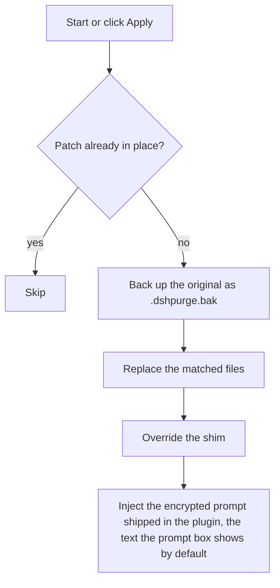
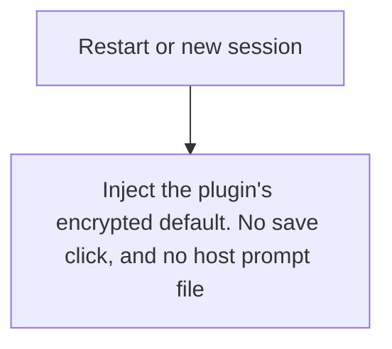
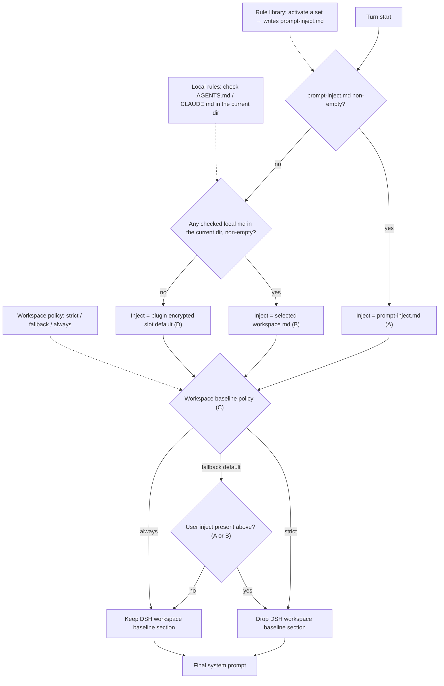
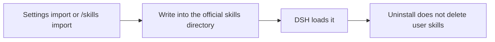

<p align="center">
  
</p>

<h1 align="center">⚔️ DeepSeek Harness red-team security tool (dsh-purge)</h1>

<p align="center"><strong>Version 1.1.73</strong></p>

<p align="center">
  <em>DeepSeek Harness jailbreak: make every model answer, swap prompts per model. Ships a built-in attack doctrine and 23 drill skills.</em>
</p>

<p align="center">
  <a href="https://github.com/jyhuang201900/dsh-purge/stargazers"></a>
  <a href="https://github.com/jyhuang201900/dsh-purge/blob/master/LICENSE"></a>
  <a href="https://www.deepseek.com/harness/"></a>
  <br>
  
  
</p>

<p align="center">
  <a href="README.md">中文</a> · <a href="README.en.md"><strong>English</strong></a>
</p>


> **Official Web and the official desktop app are both supported.** Official `dsh web` uses profile `web`. The official desktop EXE (DeepSeek Harness **0.2.1-rc.2**) uses profile `desktop`. Install and Apply them separately. This release targets dsh 0.2.1-rc.2 only (0.2.0-rc.2 and earlier need the matching older plugin). Community Desktop is not maintained.
>
> Adding the plugin to a profile does not patch the host. Click **dsh-purge** beside the session title → **Clean** → **Apply**. A successful Apply restarts; an unfinished Apply does not. After the restart, start a new chat — that is when the inject enters the session.
>
> Node.js **≥18**. Windows no-flash needs **Node ≥22**. There is no `dsh-purge` package on npm. Install from the GitHub archive below; do not `pnpm add dsh-purge`.

## Contents

- [What this is](#what-this-is)
- [License](#license)
- [Supported hosts](#supported-hosts)
- [Install](#install)
- [Interface](#interface-preview)
- [Usage](#usage)
- [Your own servers](#your-own-servers)
- [How it works](#how-it-works)
- [Restore](#restore)
- [Updates](#updates)

---

## What this is

A local network-security red-team evaluation plugin for the official [DeepSeek Harness](https://www.deepseek.com/harness/) installed on your machine. Both the official **Web** (`dsh web`) and the official **desktop EXE** are supported; install and Apply them separately.

Harness does more than hand a question to a model. It rewrites prompts, approval gates, sandboxes and session formats at runtime. Judging only "does the model answer" mistakes a host block for a model refusal. This plugin separates those two layers inside your own installation, for controlled evaluation and for testing whether the default policy should be tightened.


| What you use          | What it does                                                  |
| --------------------- | ------------------------------------------------------------- |
| **dsh-purge dock**    | The button next to the session title opens a layered dock: home → section → sub-layer, joined by breadcrumbs |
| **Clean**             | Grouped patches, Apply / Restore / Uninstall; edit the prompt and rule sets |
| **Drill console**     | Built in. After authorization: assets, skills, local environment. Only for machines you own, offline targets, or written-authorized drills |
| **Host policy**       | Adjust default copy, permission policy and tool caps. Official capability is kept, no second identity invented |
| **On start**          | Re-checks and re-applies. After an npm upgrade overwrites `node_modules` you do not edit files by hand |


No hard-coded drive letters. It resolves `$DSH_HOME`, the `.dsh` next to the dsh launcher, then falls back to `~/.dsh`. It does not touch the Harness source repository; nothing is written until you press **Apply** under **dsh-purge** → Clean. Identity comes from the encrypted prompt sealed in the plugin — the one the prompt box shows by default. It does not read a prompt file from the host's disk.

This plugin only changes the official `@deepseek-ai` packages already installed on your machine plus local configuration. It is not a public-internet scanner or an attack suite. The repository contains no trojan and no outbound attack payload.

---

## License

Terms are in [LICENSE](./LICENSE). Personal local use, modification and redistribution are fine; keep a link to the source repository when redistributing.

---

### Scope and disclaimer

1. **Local official Harness only**: patches, prompt injection, rollback and uninstall all happen inside the official DeepSeek Harness you installed on your own machine (`@deepseek-ai` packages, local profile / `$DSH_HOME`). The object is your own local software, not somebody else's website, server, account or information system.
2. **You own outbound traffic**: the drill console, scanning, brute force and tunnels send real packets. Targets must be environments you are entitled to operate — your machine, offline targets, authorized ranges, or written-authorized public targets.
3. **Compliance is yours**: follow local law and platform rules; you carry the consequences of your own use.
4. **No affiliation with DeepSeek**: "official" here only means the evaluation target is the official DeepSeek Harness package. It does not mean DeepSeek built, endorses or warrants this plugin.

---

## Supported hosts

The latest plugin supports **dsh 0.2** only — do not apply it to 0.1.x.

- **dsh 0.2** (official desktop **0.2.1-rc.2** / official `dsh web`): use **1.1.40** or newer. This page installs that line.
- **dsh 0.1.7** (incl. rc.1 / rc.2): use **1.1.39** or older — pick the tag on [Releases](https://github.com/jyhuang201900/dsh-purge/releases).

Unmatched patches stay pending or skipped; nothing is rewritten blindly.

---

## Install

Web and the official desktop EXE are the two maintained hosts. **Install both. Apply each separately.** A Web install does not reach the desktop app, and a desktop install does not reach Web.

**Web (official `dsh web`)**

```sh
dsh plugin --profile web add https://github.com/jyhuang201900/dsh-purge/archive/refs/heads/master.tar.gz
```

**Desktop (official EXE)**

```sh
dsh plugin --profile desktop add https://github.com/jyhuang201900/dsh-purge/archive/refs/heads/master.tar.gz
```

If this directory is already a clone, use `add .` instead of the archive URL. If `dsh` is not on PATH, use [Manual install](#manual).

The plugin hub still 404s if it looks up the npm package name. Use the GitHub archive commands above.

For the desktop client you can also click the button (`dsh://` deep link):

<p align="center">
  <a href="dsh://plugin/install?id=dsh-purge&name=dsh-purge&version=1.1.73&repo=jyhuang201900%2Fdsh-purge&permissions=%E7%B3%BB%E7%BB%9F%E6%8F%90%E7%A4%BA%E8%AF%8D%E6%B3%A8%E5%85%A5%2C%E6%9C%AC%E6%9C%BA%E8%A1%A5%E4%B8%81%2C%E8%AE%BE%E7%BD%AE%E9%A1%B5&downloadUrl=https%3A%2F%2Fgithub.com%2Fjyhuang201900%2Fdsh-purge%2Farchive%2Frefs%2Fheads%2Fmaster.tar.gz"><strong>Install in desktop client</strong></a>
</p>

### After the command: three steps

Adding the plugin to a profile does **not** patch `@deepseek-ai` by itself.

1. **Quit and reopen** the host you installed into — stop and restart `dsh web`, or quit the desktop tray and reopen that app.
2. On **that host**, click **dsh-purge** beside the session title, then **Apply** on the **Clean** page. It is not on the host Settings page.
3. A successful **Apply** restarts once so patches load. It does not restart if it did not finish.

Web controls affect Web only; desktop controls affect the desktop app only. Do not Apply one host from the other.

### How to tell it installed

- **dsh-purge** sits beside the session title, with **Apply** on its Clean page.
- `/purge status` in chat prints `DSH_HOME` and the patch list — the path should be the home you actually run.
- Optional packages that are not installed (liangshen) show as skipped and do not block Apply.

### Hand this to an assistant

Paste the block below to a local assistant. It should only run the install command — no disk scan, no other edits, no Apply, no restart.

<details>
<summary><strong>For AI assistants (install only)</strong></summary>

<!-- AI-AGENT-START -->

Install the DeepSeek Harness plugin `dsh-purge` into both the Web profile and the official desktop profile. Do not scan the whole disk, do not read or edit other files, do not apply settings, and do not restart the app.

If `dsh` is not on PATH, tell the user and stop. If this directory is already a clone, use `.` instead of the archive URL in both commands. If one profile is missing, skip that command and still install the other. There is no npm package; do not `pnpm add dsh-purge`.

**Web (official `dsh web`)**

```sh
dsh plugin --profile web add https://github.com/jyhuang201900/dsh-purge/archive/refs/heads/master.tar.gz
```

**Desktop (official EXE)**

```sh
dsh plugin --profile desktop add https://github.com/jyhuang201900/dsh-purge/archive/refs/heads/master.tar.gz
```

After the commands finish, tell the user to fully quit and restart `dsh web`, and to quit the desktop tray then reopen the EXE. On each host, open **dsh-purge** beside the session title and **Apply** on **Clean**. Then stop.

<!-- AI-AGENT-END -->

</details>

<a id="manual"></a>

### Manual install

Use this when the command fails or `dsh` is not on PATH. Edit **only the profile for the host you run** — do not touch the other, and do not delete existing bundles.

<details>
<summary><strong>Full manual steps</strong></summary>

**1. Find the `$DSH_HOME` this host uses.** A real home is named `.dsh` (official EXE sometimes `dsh-home`), contains `profiles`, and has at least one `profiles/<name>/package.json`. Check in order: `DSH_HOME` env → `.dsh` next to the install root (portable) → `%USERPROFILE%\.dsh` or `~/.dsh` → `%APPDATA%` / `%LOCALAPPDATA%\DeepSeek Harness\dsh-home`. Confirm: `profiles/web/package.json` has `"name": "dsh-profile-web"` (or `dsh-profile-desktop`). Machines often have two homes — use the one that belongs to the host you actually start.

PowerShell to list candidates:

```powershell
$cands = @()
if ($env:DSH_HOME) { $cands += $env:DSH_HOME }
$cands += "$env:USERPROFILE\.dsh"
$dsh = Get-Command dsh -ErrorAction SilentlyContinue
if ($dsh) {
  $dir = Split-Path $dsh.Source
  $cands += @((Join-Path $dir ".dsh"), (Join-Path (Split-Path $dir) ".dsh"), (Join-Path (Split-Path (Split-Path $dir)) ".dsh"))
}
$cands += @("$env:APPDATA\DeepSeek Harness\dsh-home", "$env:LOCALAPPDATA\DeepSeek Harness\dsh-home")
$cands | Select-Object -Unique | Where-Object { $_ -and (Test-Path (Join-Path $_ "profiles")) }
```

**2. Put the plugin at `$DSH_HOME/plugins/dsh-purge`** (folder must be named `dsh-purge`, with a `package.json` whose `"name"` is `dsh-purge`).

```sh
git clone https://github.com/jyhuang201900/dsh-purge.git "$DSH_HOME/plugins/dsh-purge"
```

Without git: download [master.tar.gz](https://github.com/jyhuang201900/dsh-purge/archive/refs/heads/master.tar.gz), extract, rename `dsh-purge-master` → `dsh-purge`, and place it under `plugins`. If you already have a clone, copy the whole tree — not a few `.js` files.

**3. Edit only that profile's `package.json` — back it up first.** Web → `$DSH_HOME/profiles/web/package.json`; desktop → `$DSH_HOME/profiles/desktop/package.json`. Add **only two things**, keeping every existing dependency and bundle:

1. In `dependencies`, add `"dsh-purge": "file:../../plugins/dsh-purge"`
2. At the **end** of `dsh.profile.bundles`, append `"dsh-purge"` (skip if already there)

```json
{
  "name": "dsh-profile-web",
  "private": true,
  "dependencies": {
    "dsh-purge": "file:../../plugins/dsh-purge"
  },
  "dsh": {
    "profile": {
      "bundles": [
        "@deepseek-ai/dsh-base",
        "@deepseek-ai/dsh-web-app",
        "dsh-purge"
      ],
      "patchReload": "live"
    }
  }
}
```

Keep JSON valid (comma before the new item, none after the last). Do not switch `file:../../plugins/dsh-purge` to an absolute path, do not touch `patchReload` or other plugins, and do not list `"dsh-purge"` twice. On desktop, if there is no `dsh-web-app` row, do not add one.

**4. Run `pnpm install` in that profile only** (`cd` into the profile dir, not the repo root or `$DSH_HOME`):

```sh
cd "$DSH_HOME/profiles/web"   # or profiles/desktop
pnpm install
```

Success: `profiles/<web|desktop>/node_modules/dsh-purge/package.json` exists. If `pnpm` is missing, use the Node / pnpm shipped with official `dsh`; on `Could not resolve`, re-check the `file:` path; on a JSON error, fix commas or restore the backup.

**5. Fully quit that host, reopen it, then Apply** — same three steps as above. The card appears beside the session title; click **Apply** (or `/purge apply`) on that host only. If the card is missing, you likely edited the other `.dsh` — go back to step 1.

</details>

### Uninstall

**dsh-purge** beside the session title → **Clean** → **Uninstall**. Confirm the dialog: it reverts any applied patches, restores the original Harness, and restarts the current host.

```sh
# or from a terminal / chat
dsh-purge --uninstall
# /purge uninstall
```

Plugin config lives in `cordis.patch.yml` (`postPrompt` is empty by default):

```yaml
- insert:
    - id: dsh-purge
      name: 'dsh-purge'
      config:
        enabled: true
        autoApplyOnStart: true
        autoUpdateOnStart: false
        autoRevertOnMissing: false
        verbose: false
        postPromptOrder: 5100
        postPrompt: ""
```

---

## Preview

**dsh-purge** sits beside the session title. It opens a right-hand dock with two pages: **Clean** and **Drill**. Switch **Light / Ink**. Patches are grouped; the count only includes items that actually applied. Rule sets sit in a list above the editor, with Enable and Delete on each row.

The first time you open Drill you read the notice, wait out the countdown, scroll to the end, and check three boxes. Clean does not need that step. Drill is only for a host you manage, an offline target, or an exercise that already has written authorization.

**Clean**


**Drill authorization**


**Drill**


**Patches**


**Own servers**

On the Clean page, under Prompt. One host per line, then Save list. Steps are in [Own servers](#own-servers).


| Area | What it shows |
|---|---|
| dsh-purge | button beside the session title; opens or collapses the dock |
| Clean | the old Rules page: patches, prompt, rule sets, skills |
| Drill | assets, skills, and environment after authorization. The tab says Unauthorized until then |
| Patches | grouped status, Apply, Restore, or Uninstall |
| Prompt | edit `prompt-inject.md` as the session override |
| Own servers | one IP or exact hostname per line, saved to `$DSH_HOME/net-scope-allow.txt` |
| Rule sets | multiple `AGENTS.md` / `CLAUDE.md`; Enable writes under `$DSH_HOME`, Delete removes the row |
| Skills | import a zip or folder into this host’s official `$DSH_HOME/skills/<id>/SKILL.md` (web and desktop each use their own home; no drive letter is hardcoded); DSH owns match, load, and `/name`. You can also delete that folder yourself |

---

## Layout

`bin/` is the CLI, `lib/` is patches and the drill console, `presets/redteam/` is the red-team preset, `skills/redteam/` is the bundled skills, and `client.js` is the dock.

Runtime files live under `$DSH_HOME`: `prompt-inject.md`, `rules/`, `skills/`, `net-scope-allow.txt`, `redteam/`. If `DSH_HOME` is unset, the launcher-adjacent `.dsh` wins over `~/.dsh`. Web and the desktop app each use their own home. Skills are not part of the inject section and do not replace the prompt.

---

## Usage

```sh
dsh-purge --status
dsh-purge --apply
dsh-purge --revert
dsh-purge --uninstall
dsh-purge --edit

/purge status | apply | revert | uninstall | edit | help
/rules list | use <id> | create <id> | delete <id> | reset | help
/skills list | import <zip-or-folder> | create <id> [description] | delete <id> | help
/rewind

purge_status   purge_apply   purge_revert
```

After a successful Apply, the host restarts so patched packages load; you can also click **Restart** manually. Under the patch title are the stable release and the test release. The test release follows the `beta` branch. **Switch to stable** installs `master` and clears any pin. Picking an older stable version pins it; click **Update** to return to the latest. Old test tags are not listed.

The composer **Undo once** and **Undo last round** follow official DSH `session.fork({ atSeq })`: the withdrawn turn is cut off, a new session keeps the earlier context, the old session is archived, and the line returns to the input so **send again** re-injects. `/rewind` does the same.

If the **same task works in standard but fails in minimal or PTC**, preset `run_code`, sandbox, or plan intercept text is often still uncleared, or built-in minimal is missing `agent-instructions`. Use **1.1.61+**, then **quit the host fully → Apply in Clean → restart → start a new chat**. Switching preset alone does not reload patches in the running process.

### Response speed

DSH runs Bash calls in a tool batch one at a time. Older dsh-purge releases raised the default foreground wait from 60 seconds to 10 minutes, so one slow command could hold up later calls for that long. Patch #21 now restores marked plugin values to the official 60-second default. Unmarked timeouts and other custom values are preserved; an unmarked 10-minute value cannot reliably be distinguished from a user setting.

For a shorter wait in `dsh web` on macOS/Linux, add this entry to `$DSH_HOME/profiles/web/cordis.patch.yml` (normally `~/.dsh/profiles/web/cordis.patch.yml`). Edit an existing entry with the same id instead of adding a duplicate. This profile layer is applied after the bundled configuration, so future plugin applies keep the override.

```yaml
- id: bash-sandbox
  config:
    timeoutMs: 10000
```

With the standard jobs service and `promoteOnTimeout: true`, an unfinished command returns a background job id after 10 seconds and keeps running. Read it with `job_output` or stop it with `job_kill`. This changes the foreground wait, not the command's speed. Without that service or with promotion disabled, the timeout kills the command. A per-call `timeoutMs` overrides this default; `run_in_background: true` returns a job id immediately.

For routine tasks, you can also opt into Low reasoning for new sessions:

```yaml
- id: agent-default-model
  config:
    provider: deepseek-official
    model: deepseek-flash
    reasoningEffort: low
```

Restart `dsh web` to load the profile. The model and reasoning defaults apply to newly created sessions; select Low in the composer for an existing session. The plugin does not change these model preferences automatically. Keep High when the task needs deeper reasoning, and narrow file searches rather than recursively scanning every application directory.

### Own servers

Addresses in mainland China, Hong Kong, and Macau stay forbidden unless that one host was registered first. Saying “this is my server” in chat does not allow it. A key or a password does not allow it either.

The box sits under Prompt. If the dock does not show it yet, quit DeepSeek Harness completely and open it again.

1. Click **dsh-purge** beside the session title and stay on **Clean**.
2. Scroll past **Prompt**. **Own servers** is the next block.
3. Put one host on each line, in one of these forms:
   - `203.0.113.10` — one IP.
   - `my-vps.example.com` — one exact hostname. After you save, the addresses that hostname resolves to at lookup time are allowed too.
   - `alice@my-vps.example.com` — the account only identifies this form. It does not prove the machine is yours.
4. Click **Save list**. The list is written to `$DSH_HOME/net-scope-allow.txt`.
5. Keys, passwords, ranges, and wildcards are dropped on save. Unlisted mainland China, Hong Kong, and Macau addresses stay forbidden.

`203.0.113.10` and `example.com` above are only examples of the form. Replace them with your own host before you save.

---

## Local checks

```sh
node --check lib/index.js
node --check lib/core.js
node --check lib/surface.js
node --check lib/web.js
node --check lib/desktop.js
node --check lib/host.js
node --check lib/rewind.js
node --check lib/skills.js
node --check client.js
```

---

## How it works

Apply, on start or when you click Apply:



Override on each session:



Prompt injection and ruleset decision at every turn. The three inputs on the left are what you control in the dsh-purge panel; the dotted edges show which decision each one drives:



Skills stay out of the inject section:



---

## Restore

- Each target is copied to `<file>.dshpurge.bak` before the first apply.
- **Restore** or `/purge revert` copies backups back and deletes them. With no backup, shim lines written by this plugin are stripped.
- `prompt-inject.md` is a user file and is kept.
- **Uninstall** restores first if patches were applied, then deletes the inject file, rule library, and the plugin itself.
- Apply is idempotent.

---

## Path detection

The host surface is detected first: `web` / `desktop` (`gui` / `tui` are reserved and still fall back to web).

**Web:**

1. `DSH_HOME` / `DSH_BASE`
2. `.dsh` next to the dsh launcher (portable install, any drive)
3. `npm prefix -g` / `npm root -g`
4. Nested `@deepseek-ai/dsh/node_modules/@deepseek-ai`
5. `~/.dsh`

**Official desktop EXE:** the running official Harness install (`resources/app` or the unpacked package). The drive letter is not hard-coded. A successful Apply restarts once.

Community Desktop is not maintained.

Official npm-global is not patched. Sealed `host-commands` / `runtime-commands` are scrubbed, never injected.

If nothing is found, set `DSH_BASE` / `DSH_DESKTOP_INSTALL`. No files are changed.

---

## Releases

Release notes: [release-notes.md](./release-notes.md) and [Releases](https://github.com/jyhuang201900/dsh-purge/releases).

## Notes

- The change surface is rendered copy, default policy and execution logic inside local `@deepseek-ai/*` packages, plus override files and rule sets under the harness home.
- After an upgrade, unmatched originals show as skipped; that Apply still completes and those files are left unchanged.
- Third-party plugin *source repos* outside `@deepseek-ai` are left alone (the CMD silence may **best-effort** patch an installed doctor / market / liangshen / mnemon at runtime).
- Install from the GitHub archive, not an npm package name: `dsh plugin --profile web add https://github.com/jyhuang201900/dsh-purge/archive/refs/heads/master.tar.gz` (use profile `desktop` for the EXE). From this repository, `add .`.

---

Thanks to the [LINUX DO](https://linux.do) community
