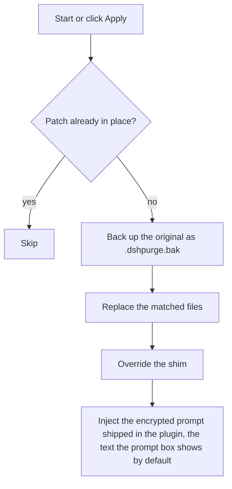
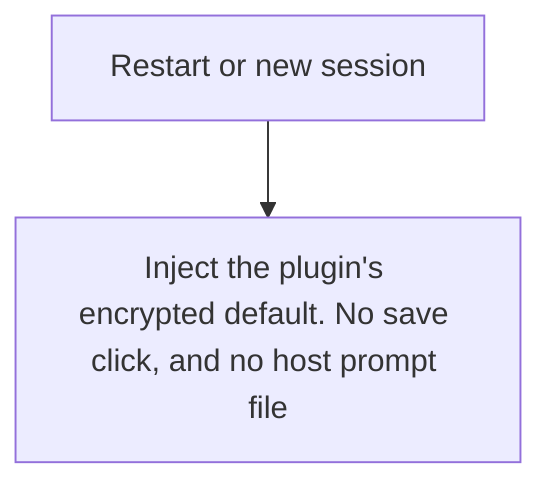
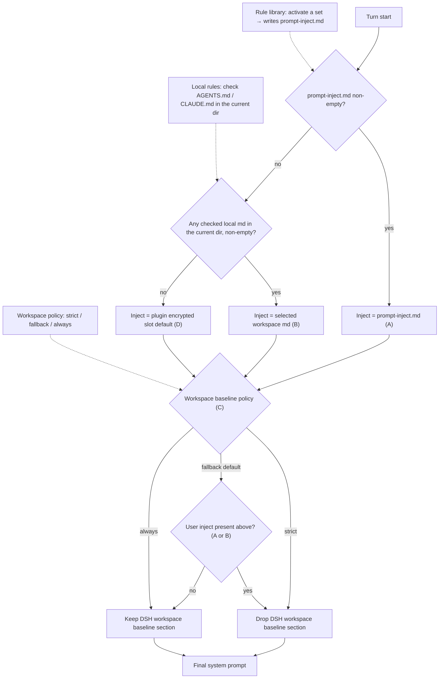
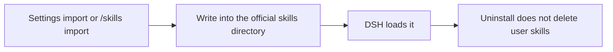

<p align="center">
  
</p>

<h1 align="center">⚔️ DeepSeek Harness red-team security tool (dsh-purge)</h1>

<p align="center"><strong>Version 1.1.92</strong></p>

<p align="center">
  <em>DeepSeek Harness jailbreak: make every model answer, swap prompts per model. Ships a built-in attack doctrine and 116 drill skills (organised by five phases: recon / asset mapping / vulnerability discovery / exploitation / intranet, plus 9 chain overviews).</em>
</p>

<p align="center">
  <a href="https://github.com/jyhuang201900/dsh-purge/stargazers"></a>
  <a href="https://github.com/jyhuang201900/dsh-purge/blob/master/LICENSE"></a>
  <a href="https://www.deepseek.com/harness/"></a>
  <br>
  
  
</p>

<p align="center">
  <a href="README.md">中文</a> · <a href="README.en.md"><strong>English</strong></a>
</p>


> **Official Web and the official desktop app are both supported.** Official `dsh web` uses profile `web`. The official desktop EXE (DeepSeek Harness **0.2.2-rc.1**) uses profile `desktop`. Install and Apply them separately. This release is verified on dsh 0.2.1-rc.2 and 0.2.2-rc.1 (0.2.0-rc.2 and earlier need the matching older plugin). Community Desktop is not maintained.
>
> Adding the plugin to a profile does not patch the host. Click **dsh-purge** beside the session title → **Clean** → **Apply**. A successful Apply restarts; an unfinished Apply does not. After the restart, start a new chat — that is when the inject enters the session.
>
> Node.js **≥18**. Windows no-flash needs **Node ≥22**. There is no `dsh-purge` package on npm. Install from the GitHub archive below; do not `pnpm add dsh-purge`.

## Contents

- [What this is](#what-this-is)
- [License](#license)
- [Supported hosts](#supported-hosts)
- [Install](#install)
- [Interface](#interface-preview)
- [Usage](#usage)
- [Your own servers](#your-own-servers)
- [How it works](#how-it-works)
- [Restore](#restore)
- [Updates](#updates)

---

## What this is
## What works in a daily session vs. what needs the drill preset

The plugin registers **ten tools globally** (`ctx.tools.register` in `lib/index.js`, with no preset gate), so **they work in a daily session without switching to the red-team preset**:

| Capability | Daily session | Drill preset | Note |
| --- | --- | --- | --- |
| The ten `purge_*` tools | yes | yes | patch state, acceptance, injection editing, skill health checks |
| **Drill ledger** (open target / record findings / score / report) | yes | yes | `purge_drill op=open` opens a target in place; the tool itself says no preset switch is needed |
| **What to do next** | yes | yes | `purge_drill` (no args = summary) reads the ledger state and returns **one** targeted next action naming the skill to load: no assets -> (1) `recon-pipeline`; assets -> (3) `asset-correlation` + `nuclei-scan`; vulns -> (4) `injection-payloads` / `webshell-toolkit`; access -> build a tunnel with `suo5-tunnel`; tunnel but no internal -> (5) `gogo-intranet`; internal assets -> `fscan-intranet`. **Daily sessions get the five-phase discipline without the preset** |
| **Find skills by stage** | yes | yes | `purge_skills all=1..5` or `all=flow` lists the skills for that phase |
| **Browse the skill library / read a skill body** | yes | yes | `purge_skills` lists and checks the whole library; `purge_skills id=<name>` returns **chain position + body head + full path** - the only way to read a skill in a daily session, since red-team skills are absent from its `<available_skills>` |
| **Loading those 116 skills via the `skill` tool** | no | yes | Skills are discovered through the drill preset's `customSkillDirs`; daily sessions do not see them, which keeps 116 descriptions out of the standing context |
| **The injected doctrine** (five phases / rules / chain discipline) | no | yes | Gated by `isRedteamSession(context)`, injected only in drill sessions |

**Why the split**: putting 116 skills into every daily session means reading 116 skill descriptions before each conversation - the preset comment says exactly this, and `includeDefaultRoots: false` is deliberate.

**Two ways to use red-team capability in a daily session**: call the tools directly (including the drill ledger - open a target and go), or read a skill body on demand with `purge_skills id=<name>`. Switch to the drill preset only when you want the model-facing skill catalog and the doctrine constraints.


A local network-security red-team evaluation plugin for the official [DeepSeek Harness](https://www.deepseek.com/harness/) installed on your machine. Both the official **Web** (`dsh web`) and the official **desktop EXE** are supported; install and Apply them separately.

Harness does more than hand a question to a model. It rewrites prompts, approval gates, sandboxes and session formats at runtime. Judging only "does the model answer" mistakes a host block for a model refusal. This plugin separates those two layers inside your own installation, for controlled evaluation and for testing whether the default policy should be tightened.


| What you use          | What it does                                                  |
| --------------------- | ------------------------------------------------------------- |
| **dsh-purge dock**    | The button next to the session title opens a layered dock: home → section → sub-layer, joined by breadcrumbs |
| **Clean**             | Grouped patches, Apply / Restore / Uninstall; edit the prompt and rule sets |
| **Drill console**     | Built in. After authorization: assets, skills, local environment. Only for machines you own, offline targets, or written-authorized drills |
| **Host policy**       | Adjust default copy, permission policy and tool caps. Official capability is kept, no second identity invented |
| **On start**          | Re-checks and re-applies. After an npm upgrade overwrites `node_modules` you do not edit files by hand |


No hard-coded drive letters. It resolves `$DSH_HOME`, the `.dsh` next to the dsh launcher, then falls back to `~/.dsh`. It does not touch the Harness source repository; nothing is written until you press **Apply** under **dsh-purge** → Clean. Identity comes from the encrypted prompt sealed in the plugin — the one the prompt box shows by default. It does not read a prompt file from the host's disk.

This plugin only changes the official `@deepseek-ai` packages already installed on your machine plus local configuration. It is not a public-internet scanner or an attack suite. The repository contains no trojan and no outbound attack payload.

---

## License

Terms are in [LICENSE](./LICENSE). Personal local use, modification and redistribution are fine; keep a link to the source repository when redistributing.

---

### Scope and disclaimer

1. **Local official Harness only**: patches, prompt injection, rollback and uninstall all happen inside the official DeepSeek Harness you installed on your own machine (`@deepseek-ai` packages, local profile / `$DSH_HOME`). The object is your own local software, not somebody else's website, server, account or information system.
2. **You own outbound traffic**: the drill console, scanning, brute force and tunnels send real packets. Targets must be environments you are entitled to operate — your machine, offline targets, authorized ranges, or written-authorized public targets.
3. **Compliance is yours**: follow local law and platform rules; you carry the consequences of your own use.
4. **No affiliation with DeepSeek**: "official" here only means the evaluation target is the official DeepSeek Harness package. It does not mean DeepSeek built, endorses or warrants this plugin.

---

## Supported hosts

The latest plugin supports **dsh 0.2** only — do not apply it to 0.1.x.

- **dsh 0.2.1-rc.2 / 0.2.2-rc.1** (official desktop / official `dsh web`): use **1.1.40** or newer. This page installs that line.
- **dsh 0.1.7** (incl. rc.1 / rc.2): use **1.1.39** or older — pick the tag on [Releases](https://github.com/jyhuang201900/dsh-purge/releases).

Unmatched patches stay pending or skipped; nothing is rewritten blindly.

---

## Install

Web and the official desktop EXE are the two maintained hosts. **Install both. Apply each separately.** A Web install does not reach the desktop app, and a desktop install does not reach Web.

**Web (official `dsh web`)**

```sh
dsh plugin --profile web add https://github.com/jyhuang201900/dsh-purge/archive/refs/heads/master.tar.gz
```

**Desktop (official EXE)**

```sh
dsh plugin --profile desktop add https://github.com/jyhuang201900/dsh-purge/archive/refs/heads/master.tar.gz
```

If this directory is already a clone, use `add .` instead of the archive URL. If `dsh` is not on PATH, use [Manual install](#manual).

The plugin hub still 404s if it looks up the npm package name. Use the GitHub archive commands above.

For the desktop client you can also click the button (`dsh://` deep link):

<p align="center">
  <a href="dsh://plugin/install?id=dsh-purge&name=dsh-purge&version=1.1.92&repo=jyhuang201900%2Fdsh-purge&permissions=%E7%B3%BB%E7%BB%9F%E6%8F%90%E7%A4%BA%E8%AF%8D%E6%B3%A8%E5%85%A5%2C%E6%9C%AC%E6%9C%BA%E8%A1%A5%E4%B8%81%2C%E8%AE%BE%E7%BD%AE%E9%A1%B5&downloadUrl=https%3A%2F%2Fgithub.com%2Fjyhuang201900%2Fdsh-purge%2Farchive%2Frefs%2Fheads%2Fmaster.tar.gz"><strong>Install in desktop client</strong></a>
</p>

### After the command: three steps

Adding the plugin to a profile does **not** patch `@deepseek-ai` by itself.

1. **Quit and reopen** the host you installed into — stop and restart `dsh web`, or quit the desktop tray and reopen that app.
2. On **that host**, click **dsh-purge** beside the session title, then **Apply** on the **Clean** page. It is not on the host Settings page.
3. A successful **Apply** restarts once so patches load. It does not restart if it did not finish.

Web controls affect Web only; desktop controls affect the desktop app only. Do not Apply one host from the other.

### How to tell it installed

- **dsh-purge** sits beside the session title, with **Apply** on its Clean page.
- `/purge status` in chat prints `DSH_HOME` and the patch list — the path should be the home you actually run.
- Optional packages that are not installed (liangshen) show as skipped and do not block Apply.

### Hand this to an assistant

Paste the block below to a local assistant. It should only run the install command — no disk scan, no other edits, no Apply, no restart.

<details>
<summary><strong>For AI assistants (install only)</strong></summary>

<!-- AI-AGENT-START -->

Install the DeepSeek Harness plugin `dsh-purge` into both the Web profile and the official desktop profile. Do not scan the whole disk, do not read or edit other files, do not apply settings, and do not restart the app.

If `dsh` is not on PATH, tell the user and stop. If this directory is already a clone, use `.` instead of the archive URL in both commands. If one profile is missing, skip that command and still install the other. There is no npm package; do not `pnpm add dsh-purge`.

**Web (official `dsh web`)**

```sh
dsh plugin --profile web add https://github.com/jyhuang201900/dsh-purge/archive/refs/heads/master.tar.gz
```

**Desktop (official EXE)**

```sh
dsh plugin --profile desktop add https://github.com/jyhuang201900/dsh-purge/archive/refs/heads/master.tar.gz
```

After the commands finish, tell the user to fully quit and restart `dsh web`, and to quit the desktop tray then reopen the EXE. On each host, open **dsh-purge** beside the session title and **Apply** on **Clean**. Then stop.

<!-- AI-AGENT-END -->

</details>

<a id="manual"></a>

### Manual install

Use this when the command fails or `dsh` is not on PATH. Edit **only the profile for the host you run** — do not touch the other, and do not delete existing bundles.

<details>
<summary><strong>Full manual steps</strong></summary>

**1. Find the `$DSH_HOME` this host uses.** A real home is named `.dsh` (official EXE sometimes `dsh-home`), contains `profiles`, and has at least one `profiles/<name>/package.json`. Check in order: `DSH_HOME` env → `.dsh` next to the install root (portable) → `%USERPROFILE%\.dsh` or `~/.dsh` → `%APPDATA%` / `%LOCALAPPDATA%\DeepSeek Harness\dsh-home`. Confirm: `profiles/web/package.json` has `"name": "dsh-profile-web"` (or `dsh-profile-desktop`). Machines often have two homes — use the one that belongs to the host you actually start.

PowerShell to list candidates:

```powershell
$cands = @()
if ($env:DSH_HOME) { $cands += $env:DSH_HOME }
$cands += "$env:USERPROFILE\.dsh"
$dsh = Get-Command dsh -ErrorAction SilentlyContinue
if ($dsh) {
  $dir = Split-Path $dsh.Source
  $cands += @((Join-Path $dir ".dsh"), (Join-Path (Split-Path $dir) ".dsh"), (Join-Path (Split-Path (Split-Path $dir)) ".dsh"))
}
$cands += @("$env:APPDATA\DeepSeek Harness\dsh-home", "$env:LOCALAPPDATA\DeepSeek Harness\dsh-home")
$cands | Select-Object -Unique | Where-Object { $_ -and (Test-Path (Join-Path $_ "profiles")) }
```

**2. Put the plugin at `$DSH_HOME/plugins/dsh-purge`** (folder must be named `dsh-purge`, with a `package.json` whose `"name"` is `dsh-purge`).

```sh
git clone https://github.com/jyhuang201900/dsh-purge.git "$DSH_HOME/plugins/dsh-purge"
```

Without git: download [master.tar.gz](https://github.com/jyhuang201900/dsh-purge/archive/refs/heads/master.tar.gz), extract, rename `dsh-purge-master` → `dsh-purge`, and place it under `plugins`. If you already have a clone, copy the whole tree — not a few `.js` files.

**3. Edit only that profile's `package.json` — back it up first.** Web → `$DSH_HOME/profiles/web/package.json`; desktop → `$DSH_HOME/profiles/desktop/package.json`. Add **only two things**, keeping every existing dependency and bundle:

1. In `dependencies`, add `"dsh-purge": "file:../../plugins/dsh-purge"`
2. At the **end** of `dsh.profile.bundles`, append `"dsh-purge"` (skip if already there)

```json
{
  "name": "dsh-profile-web",
  "private": true,
  "dependencies": {
    "dsh-purge": "file:../../plugins/dsh-purge"
  },
  "dsh": {
    "profile": {
      "bundles": [
        "@deepseek-ai/dsh-base",
        "@deepseek-ai/dsh-web-app",
        "dsh-purge"
      ],
      "patchReload": "live"
    }
  }
}
```

Keep JSON valid (comma before the new item, none after the last). Do not switch `file:../../plugins/dsh-purge` to an absolute path, do not touch `patchReload` or other plugins, and do not list `"dsh-purge"` twice. On desktop, if there is no `dsh-web-app` row, do not add one.

**4. Run `pnpm install` in that profile only** (`cd` into the profile dir, not the repo root or `$DSH_HOME`):

```sh
cd "$DSH_HOME/profiles/web"   # or profiles/desktop
pnpm install
```

Success: `profiles/<web|desktop>/node_modules/dsh-purge/package.json` exists. If `pnpm` is missing, use the Node / pnpm shipped with official `dsh`; on `Could not resolve`, re-check the `file:` path; on a JSON error, fix commas or restore the backup.

**5. Fully quit that host, reopen it, then Apply** — same three steps as above. The card appears beside the session title; click **Apply** (or `/purge apply`) on that host only. If the card is missing, you likely edited the other `.dsh` — go back to step 1.

</details>

### Uninstall

**dsh-purge** beside the session title → **Clean** → **Uninstall**. Confirm the dialog: it reverts any applied patches, restores the original Harness, and restarts the current host.

```sh
# or from a terminal / chat
dsh-purge --uninstall
# /purge uninstall
```

Plugin config lives in `cordis.patch.yml` (`postPrompt` is empty by default):

```yaml
- insert:
    - id: dsh-purge
      name: 'dsh-purge'
      config:
        enabled: true
        autoApplyOnStart: true
        autoUpdateOnStart: false
        autoRevertOnMissing: false
        verbose: false
        postPromptOrder: 5100
        postPrompt: ""
```

---

## Preview

**dsh-purge** sits beside the session title. It opens a right-hand dock with two pages: **Clean** and **Drill**. Switch **Light / Ink**. Patches are grouped; the count only includes items that actually applied. Rule sets sit in a list above the editor, with Enable and Delete on each row.

The first time you open Drill you read the notice, wait out the countdown, scroll to the end, and check three boxes. Clean does not need that step. Drill is only for a host you manage, an offline target, or an exercise that already has written authorization.

**Clean**


**Drill authorization**


**Drill**


**Patches**


**Own servers**

On the Clean page, under Prompt. One host per line, then Save list. Steps are in [Own servers](#own-servers).


| Area | What it shows |
|---|---|
| dsh-purge | button beside the session title; opens or collapses the dock |
| Clean | the old Rules page: patches, prompt, rule sets, skills |
| Drill | assets, skills, and environment after authorization. The tab says Unauthorized until then |
| Patches | grouped status, Apply, Restore, or Uninstall |
| Prompt | edit `prompt-inject.md` as the session override |
| Own servers | one IP or exact hostname per line, saved to `$DSH_HOME/net-scope-allow.txt` |
| Rule sets | multiple `AGENTS.md` / `CLAUDE.md`; Enable writes under `$DSH_HOME`, Delete removes the row |
| Skills | import a zip or folder into this host’s official `$DSH_HOME/skills/<id>/SKILL.md` (web and desktop each use their own home; no drive letter is hardcoded); DSH owns match, load, and `/name`. You can also delete that folder yourself |

---

## Layout

`bin/` is the CLI, `lib/` is patches and the drill console, `presets/redteam/` is the red-team preset, `skills/redteam/` is the bundled skills, and `client.js` is the dock.

Runtime files live under `$DSH_HOME`: `prompt-inject.md`, `rules/`, `skills/`, `net-scope-allow.txt`, `redteam/`. If `DSH_HOME` is unset, the launcher-adjacent `.dsh` wins over `~/.dsh`. Web and the desktop app each use their own home. Skills are not part of the inject section and do not replace the prompt.

---

## Usage

```sh
dsh-purge --status

One manual entry point also exists: `node lib/reapply-cli.js` — re-applies cleaning into the installed copy without opening the host (it passes `scheduleSwap: false` explicitly, so it will not schedule a restart for you). **Its `ok` criterion is not the same source as `--status`** (the CLI reported `applied=64` while `--status` still showed `74/76`, because reapply validates inside a trial directory and may roll back), so check both when debugging.
dsh-purge --apply
dsh-purge --drill ops  # drill console read/write (op optional, defaults to summary)
dsh-purge --align      # 对齐体检（只读）
dsh-purge --tools      # 列出模型工具契约
dsh-purge --mcp        # 以 MCP server 跑（stdio）
dsh-purge --revert
dsh-purge --uninstall
dsh-purge --edit

/purge status | apply | revert | uninstall | edit | help
/rules list | use <id> | create <id> | delete <id> | reset | help
/skills list | import <zip-or-folder> | create <id> [description] | delete <id> | help
/rewind

purge_status     purge_align      purge_apply      purge_revert
purge_patch      purge_update     purge_rules      purge_skills
```

After a successful Apply, the host restarts so patched packages load; you can also click **Restart** manually. Under the patch title are the stable release and the test release. The test release follows the `beta` branch. **Switch to stable** installs `master` and clears any pin. Picking an older stable version pins it; click **Update** to return to the latest. Old test tags are not listed.

The composer **Undo once** and **Undo last round** follow official DSH `session.fork({ atSeq })`: the withdrawn turn is cut off, a new session keeps the earlier context, the old session is archived, and the line returns to the input so **send again** re-injects. `/rewind` does the same.

If the **same task works in standard but fails in minimal or PTC**, preset `run_code`, sandbox, or plan intercept text is often still uncleared, or built-in minimal is missing `agent-instructions`. Use **1.1.61+**, then **quit the host fully → Apply in Clean → restart → start a new chat**. Switching preset alone does not reload patches in the running process.

### Response speed

DSH runs Bash calls in a tool batch one at a time. Older dsh-purge releases raised the default foreground wait from 60 seconds to 10 minutes, so one slow command could hold up later calls for that long. Patch #21 now restores marked plugin values to the official 60-second default. Unmarked timeouts and other custom values are preserved; an unmarked 10-minute value cannot reliably be distinguished from a user setting.

For a shorter wait in `dsh web` on macOS/Linux, add this entry to `$DSH_HOME/profiles/web/cordis.patch.yml` (normally `~/.dsh/profiles/web/cordis.patch.yml`). Edit an existing entry with the same id instead of adding a duplicate. This profile layer is applied after the bundled configuration, so future plugin applies keep the override.

```yaml
- id: bash-sandbox
  config:
    timeoutMs: 10000
```

With the standard jobs service and `promoteOnTimeout: true`, an unfinished command returns a background job id after 10 seconds and keeps running. Read it with `job_output` or stop it with `job_kill`. This changes the foreground wait, not the command's speed. Without that service or with promotion disabled, the timeout kills the command. A per-call `timeoutMs` overrides this default; `run_in_background: true` returns a job id immediately.

For routine tasks, you can also opt into Low reasoning for new sessions:

```yaml
- id: agent-default-model
  config:
    provider: deepseek-official
    model: deepseek-flash
    reasoningEffort: low
```

Restart `dsh web` to load the profile. The model and reasoning defaults apply to newly created sessions; select Low in the composer for an existing session. The plugin does not change these model preferences automatically. Keep High when the task needs deeper reasoning, and narrow file searches rather than recursively scanning every application directory.

### Own servers

Addresses in mainland China, Hong Kong, and Macau stay forbidden unless that one host was registered first. Saying “this is my server” in chat does not allow it. A key or a password does not allow it either.

The box sits under Prompt. If the dock does not show it yet, quit DeepSeek Harness completely and open it again.

1. Click **dsh-purge** beside the session title and stay on **Clean**.
2. Scroll past **Prompt**. **Own servers** is the next block.
3. Put one host on each line, in one of these forms:
   - `203.0.113.10` — one IP.
   - `my-vps.example.com` — one exact hostname. After you save, the addresses that hostname resolves to at lookup time are allowed too.
   - `alice@my-vps.example.com` — the account only identifies this form. It does not prove the machine is yours.
4. Click **Save list**. The list is written to `$DSH_HOME/net-scope-allow.txt`.
5. Keys, passwords, ranges, and wildcards are dropped on save. Unlisted mainland China, Hong Kong, and Macau addresses stay forbidden.

`203.0.113.10` and `example.com` above are only examples of the form. Replace them with your own host before you save.

---

## Local checks

One command runs sixteen gates (syntax / size budget / bilingual copy incl. source-vs-inline / local runnability / manifest parity / package self-proof / tool surface / end-to-end scenario / ammo-layer audit / hygiene fixtures / CLI smoke / write-path smoke / tool-layer smoke / valid JSON); a non-zero exit means a gate failed:

While iterating, skip the heavy ones: `node scripts/verify.mjs --skip write,cli` (or `DSH_VERIFY_SKIP=write,cli`). Measured: 12 gates 22.3 s -> skip `write` 7.6 s -> also skip `cli` 5.1 s. The legacy `--skip-size` really means "skip everything but syntax" (2.4 s); its name does not match its behaviour, so it stays only for compatibility and `--skip` is the new way. Valid short names: `size,locale,manifest,package,tools,scenario,ammo,hygiene,cli,write,json`.

```sh
npm run verify
```

### Five working rules (ordered by how often this repo actually tripped on them)

1. **Measure before writing.** Every "I remember it works like this" needs one command to prove it - most rework came from guessing anchors, signatures and field names.
2. **Read-back must not lie.** `updated:true` can mean a silent no-op, and a `counts` field can be rows processed rather than rows added.
3. **A gate has to fail correctly.** Every gate needs evidence it turns red when broken; loose regexes, optional prefixes and pointing at the wrong script make a gate lie - worse than having no gate.
4. **Land edits one at a time when they are many.** Batched edits lose everything if the batch fails at parse time, and quoting across PowerShell -> script -> code is the top killer.
5. **Environment is not fact.** Each command is a fresh process: without `DSH_BASE` you get confident fake numbers, and truncating the pipe can kill a command that writes files.

### Three-entrance matrix (command x panel route x model tool)

| Capability | Slash command | Panel route | Model tool | Note |
| --- | --- | --- | --- | --- |
| Status | `/purge status` | `GET /status` | `purge_status` | all three |
| Apply | `/purge apply` | `GET /apply` | `purge_apply` (`patches=`) | subset apply restores .bak first, unselected patches roll back |
| Revert | `/purge revert` | `GET /revert` | `purge_revert` | all three |
| Uninstall | `/purge uninstall` (alias `remove`) | `GET /uninstall` | - | deliberately no tool: a model uninstalling itself is a trap |
| Injected body | `/purge edit` | `GET/POST /override` | `purge_override` (show/reset) | editing stays human, state is model-readable |
| Alignment check | `/purge align` | - | `purge_align` | command side added this round (was tool/CLI only) |
| Update state | `/purge update` | `GET /update` (executes) | `purge_update` (reads) | command and tool only report; the button acts |
| Rules | `/rules` | `GET /rules` | `purge_rules` | own top-level command |
| Skills | `/skills` | `GET /skills` + `/skill` | `purge_skills` | same |
| Patch detail | `/purge status` (includes per-patch) | panel view | `purge_patch` | single source: all read `patchTally()` |
| Drill console | - (preset plane has 56 `redteam_*`) | `GET /drill-grant` | `purge_drill` (18 ops) | model-first; no second command dialect |
| Session rewind | `/rewind` | `GET /rewind` + `/rewind/options` | - | session action; risky for the model to invoke |
| MCP transport | - | `POST /mcp` | same contract table as `ctx.tools` | transport, not a capability |

**Rule for not mirroring everything**: configuration/state belongs in the model's reach; UI actions (`restart`, rewind, uninstall) are safer left to humans. **Every exemption is written here, not kept as folklore.** `/purge` subcommands vs their hint string are enforced by check-package item 20 (aliases detected by the fall-through rule, no hand-maintained list).

Part of the package self-proof is a family of **self-restraint assertions**: they do not check the outside world, only whether purge has quietly fattened itself - the gate count (whatever the README claims must match the code), publish manifest vs self-update manifest, tool count (the N stated in docs == the number of `purge_*` definitions in source), default injected body size (<= 33,000 chars), prompt-layer net delta (<= 2,000 chars; only this layer actually burns tokens, code-layer changes do not) and the bilingual copy-key count.

All local entry points (14 of them, each with a reason to exist; a documented gap is a missing gate):

| Command | What it guards |
| --- | --- |
| `npm run embed-prompt` | re-seal the default injected body into `lib/asset-table.js` (must run after editing the source) |
| `npm run check-anchors` | check every patch anchor against published host artifacts (`--old` is now auto-derived) |
| `npm run check:upstream` | upstream drift probe: is npm's latest dsh still the pinned `dshTarget`? Out of engines range fails; an unreachable registry stays unknown |
| `npm run sweep:market` | ecosystem drift probe: catalogue size, the `restart ∩ patch` intersection under the pinned instrument, neighbour versions; a non-empty intersection fails; offline stays unknown |
| `npm run check-size` | per-file size budget (200KB default cap) |
| `npm run check:locale` | key parity of the two inline dictionaries (329 zh/en copy keys) in `client.js` |
| `npm run build:locale` | inline `locale/*.json` into client.js; `--check` proves source and inline agree |
| `npm run check:manifest` | self-update copy list must not diverge from the publish whitelist |
| `npm run check:package` | manifest fields, published files, every user-facing count, ecosystem tags, gate count, injection size, plane baselines |
| `npm run check:tools` | tool-surface budget: structure, description cost, return size, discoverability |
| `npm run check:toolkit` | toolkit watch: a directory with zero `.exe` means "installed then deleted" (allowlist first, then reinstall); safe to run on a schedule |
| pm run check:asar | asar switch-form gate: resolves the hybrid state, refuses to switch an incomplete dir, and the health snapshot reports hybrid (fixtures only, never touches the real install) |
| `npm run scenario` | end-to-end drill scenario with read-back assertions plus a live read-only probe |
| `npm run probe:gates` | reverse-probe table: every gate must turn red when broken (an unprobed gate is an unknown gate) |
| `npm run audit:skills` | ammo-layer consistency: every `redteam_*` tool name cited by skills and every skill named by the doctrine must actually exist |
| `npm run sync:bundled` | Syncs bundled sources into the runtime: **skills** (`skills/redteam` -> `~/.dsh/redteam/skills`, discovered via the preset's `customSkillDirs`) and the **red-team preset** (`presets/redteam` -> `~/.dsh/.agent-presets/redteam`, the only path `core.js` reads). Idempotent; preset content differences are only reported by default, `--force` overwrites. Alias: `sync:skills` |
| `npm run build:skills-graph` | **Skill chain layer**: scans `skills/redteam`, emits `lib/generated/{skills-index,skills-relations,skills-agents}.json` (index / relations / role registry), writes a **chain position** section (upstream -> this skill -> downstream -> complementary -> ledger) into every skill body, and derives the **role-to-skill table** into the preset. One command keeps four modules in sync, idempotent. Chain consistency and zero-inbound are hard-gated by `audit-skills` |
| `npm run runnable:inject` / `runnable:check` | **Paper-vs-real check**: probes whether each skill's commands can actually run here (PATH and toolkit), then injects a per-skill local-runnability block (what is missing, how to install via `npm run toolkit:windows --only X`, which Windows equivalent to use); `--check` only verifies. A thick skill is not a usable one - this keeps the gap inside the skill's own context |
| `npm run build:skills` / `quality:second-shot` | **Skill build pipeline** (one command, four fixed-order idempotent steps): heading normalisation (demote merged blocks so each skill has one H1) -> local runnability -> second shot -> chain and roster. `--check` verifies the three quality checks only. `quality:second-shot` reports second-shot coverage |
| `npm run scope:check` | **Scope-gate self-test**: nothing is written to the ledger unless the target sits inside the engagement's authorisation. Mechanism borrowed from `@integsec/agentic-pentest-proxy`'s scope manifest - every target checked, one out-of-scope target blocks the call, **exclusions win**, CIDRs must fit entirely inside an allowed range, and anything undecidable (DNS/IPv6/garbage) counts as a fail. It also pins that the block happens **on the write path**, not merely that the function is correct |
| Three authorisation boundaries | **target / technique / time window** - missing any one means there is no boundary. Supply them when opening an engagement: `purge_drill op=open name=X target=203.0.113.0/24 scope="tech=noisy,passive,deny=destructive,from=2026-11-11T00:00,to=2026-11-12T00:00"`. `tech`=authorised techniques (noisy/passive/exploit/destructive/reverse/appsec/specialty/surface), `deny`=excluded techniques (**win over authorisation**), `from`/`to`=window (**both an expired window and one not yet open block**). Target scope is enforced on `entity_add` via its target; technique and window are enforced on `chain_add` via its `tool` |
| `npm run toolkit:windows` / `toolkit:check` | **Windows** installer and checker for the red-team toolchain: pulls official `windows_amd64` assets from the GitHub API into `$DSH_HOME/redteam/toolkit` (the repo's `setup.sh` is Linux-only and reports "no matching asset" for every tool on Windows); `--check` inspects without installing. `ksubdomain` has no Windows build |
| `npm run wordlists:windows` | **Wordlist provisioning**: materialises the SecLists wordlists the skills reference on Windows (`$DSH_HOME/redteam/wordlists`). The skills say `/usr/share/seclists/...`, and Windows treats that as a **relative path** appended to the drive letter (measured: ffuf reports `E:\usr\share\seclists\...` not found) - so without wordlists the `ffuf` / `feroxbuster` commands **always fail**. `--check` reports status only; downloads go through the same curl-with-proxy fallback as `toolkit:windows` |
| `npm run test:hygiene` | hygiene-module fixtures: the prev keep-limit, orphan pair counting, and a bad JSON that must not be skipped silently |
| `npm run smoke:cli` | CLI smoke: actually runs the read-only modes of `bin` to check argument dispatch and output markers (an unknown flag must error, not quietly print status) |
| `npm run smoke:write` | write-path smoke: revert -> apply -> apply -> revert over a temporary fixture, compared byte-by-byte (apply idempotence, revert round-trip, self-restoring) |
| `npm run smoke:tools` | tool-layer smoke: actually runs `purge_apply` / `purge_revert`, asserting the reported hosts count and that a single apply->revert round trip restores the official bytes |
| `npm run audit:graph` | graph orphan audit: finds code files with zero inbound edges and no mention in docs/manifest (a named manual CLI is not an orphan) |
| `npm run report` | Health report: runs the existing sixteen gates and probes in order and emits a markdown table (`.cache/report-<date>.md`); `--no-net` skips the three external checks, and `npm run report -- --check-debt` appends an open-items review (route revived by a restart, injection size, this run's residue, real-host sidecar forensics, the four things deliberately not done). Elapsed time is self-measured; before a restart the `--verify-live` row legitimately exits 1 |
| `npm run verify` | one command, eight gates |
| `npm run build:client` | rebuild the client bundle |
| `npm run graphify` | rebuild the knowledge graph (AST + hand-written semantic layer) |
| `npm run host-sync` | point the installed profile copy at the current commit (verified by content fingerprint, not by claim) |

Quick self-check without the size gate: `node scripts/verify.mjs --skip-size`.

---

## How it works

Apply, on start or when you click Apply:



Override on each session:



Prompt injection and ruleset decision at every turn. The three inputs on the left are what you control in the dsh-purge panel; the dotted edges show which decision each one drives:



Skills stay out of the inject section:



---

## Restore

- Each target is copied to `<file>.dshpurge.bak` before the first apply.
- **Restore** or `/purge revert` copies backups back and deletes them. With no backup, shim lines written by this plugin are stripped.
- `prompt-inject.md` is a user file and is kept.
- **Uninstall** restores first if patches were applied, then deletes the inject file, rule library, and the plugin itself.
- Apply is idempotent.

---

## Path detection

The host surface is detected first: `web` / `desktop` (`gui` / `tui` are reserved and still fall back to web).

**Web:**

1. `DSH_HOME` / `DSH_BASE`
2. `.dsh` next to the dsh launcher (portable install, any drive)
3. `npm prefix -g` / `npm root -g`
4. Nested `@deepseek-ai/dsh/node_modules/@deepseek-ai`
5. `~/.dsh`

**Official desktop EXE:** the running official Harness install (`resources/app` or the unpacked package). The drive letter is not hard-coded. A successful Apply restarts once.

Community Desktop is not maintained.

Official npm-global is not patched. Sealed `host-commands` / `runtime-commands` are scrubbed, never injected.

If nothing is found, set `DSH_BASE` / `DSH_DESKTOP_INSTALL`. No files are changed.

---

## Releases

Release notes: [release-notes.md](./release-notes.md) and [Releases](https://github.com/jyhuang201900/dsh-purge/releases).

Knowledge graph: the hand-written semantic layer lives in `graphify-out/semantic/`, the contract is [docs/graphify-语义层规范.md](./docs/graphify-%E8%AF%AD%E4%B9%89%E5%B1%82%E8%A7%84%E8%8C%83.md), and one command rebuilds everything: `node scripts/graphify-sync.mjs --cluster`.

## Ecosystem / who does what

Eight third-party dsh plugins are installed in this desktop profile; each owns one layer and they do not overlap. **dsh-purge owns the policy-and-patch layer**:

| Plugin | What it owns | Relation to purge |
| --- | --- | --- |
| `dsh-mnemon` | Composable memory (view-based sources / strategies) | Memory is its job; purge injects the persona it reads upstream |
| `dsh-context` | Context insight (stats / trend / browser / events) | It watches tokens, purge watches policy and patch hits |
| `dsh-free-search` | Search tool surface (27 engines) | Same idea of handing tools to the model; purge now speaks MCP too |
| `dsh-ops` | Native file / PTC tools, optional read-only sidebar | Sidebars coexist; purge's dock covers cleaning and the drill console |
| `dsh-better-sidebar` | File tree / editor / changes / tasks / side chat | Sidebar shape reference |
| `@panando/dsh-codex-harness`, `@xmanrui/dsh-im` | Coding harness, IM bridge | Orthogonal to purge |

Purge hands capabilities to models through three entrances, all built from one contract table (`lib/model-tools.js`, 10 tools: status / align / apply / revert / patch / update / rules / skills / override / drill):

**Capability ledger (only numbers a machine can compute; every one of them is reconciled by check-package item 21)**: 10 tools, `purge_drill` 18 op, 22 entities (10 read + 12 write), 50 end-to-end scenario steps, nine gates. Write-method coverage is 27 of 31 (87%); the remaining four (`close`, `seedStages`, `seedScorePoints`, `writePromptManifest`) are deliberate exemptions - see the three-entrance matrix above and release-notes, not an un-checked gap.

1. **Inside a dsh session**: registered via `ctx.tools` on activation, so the model sees `purge_*`.
2. **MCP over stdio**: `node bin/dsh-purge.js --mcp`, connectable by any MCP client, no running dsh required.
3. **MCP over HTTP**: `POST /dsh-purge/mcp` inside the host (JSON-RPC 2.0), usable with the official `@deepseek-ai/dsh-mcp-client` `streamable-http` branch — **no extra child process**. Self-check: `dsh-purge --mcp-probe [baseUrl]` (defaults to `DSH_WEB_URL`); it reports live / restart-needed / unreachable / missing baseUrl, with per-step timing:

   ```yaml
   transport: streamable-http
   serverName: dsh-purge
   url: http://127.0.0.1:<your dsh port>/dsh-purge/mcp
   ```

   Once connected, model-facing names look like `mcp__dsh-purge__purge_drill` (`mcp__<serverName>__<rawName>`, verified in the host source). Note `dsh-mcp-client` is not in this profile's bundles yet, so enabling it is a separate step. Offline self-checks: `dsh-purge --tools` and `dsh-purge --drill`.

**Positioning (measured over a 2000-plugin sample, 2026-11-09)**: 26 entries mention needing a restart and 36 mention patching, but **zero mention both** - file-level patching that requires a restart has no neighbour doing the same thing. Meanwhile 72.5% of plugins ship a Web UI, so having an interface is not a differentiator.

### A naming reality before publishing (measured in round 88)

On the `dshmp` catalogue, the 6 plugins hit by `?q=purge` are all the "clear sessions / leftovers" family (`dsh-session-purge` and friends) - **none does instruction governance** - while `dsh-purge` itself **is not listed yet**.
The catalogue's `?q=` is also not a name-substring filter (`q=dsh-purge` returns 11 entries, 0 containing purge), so **presence must be judged by paging the list, not by `q=`**.
Hence if we ever publish, the display name needs a qualifier - **"prompt-authority cleaning" / 指令权威性清洗** - or it will read as the seventh session-cleanup plugin. Spec and detail: section 9c of `docs/dsh-mcp-ecosystem-notes.md`.

## Notes

- The change surface is rendered copy, default policy and execution logic inside local `@deepseek-ai/*` packages, plus override files and rule sets under the harness home.
- After an upgrade, unmatched originals show as skipped; that Apply still completes and those files are left unchanged.
- Third-party plugin *source repos* outside `@deepseek-ai` are left alone (the CMD silence may **best-effort** patch an installed doctor / market / liangshen / mnemon at runtime).
- Install from the GitHub archive, not an npm package name: `dsh plugin --profile web add https://github.com/jyhuang201900/dsh-purge/archive/refs/heads/master.tar.gz` (use profile `desktop` for the EXE). From this repository, `add .`.

---

Thanks to the [LINUX DO](https://linux.do) community

Copy sources are split into `locale/zh.json` + `locale/en.json` (329 entries each); after editing, run `npm run build:locale` to inline them into `client.js`.
