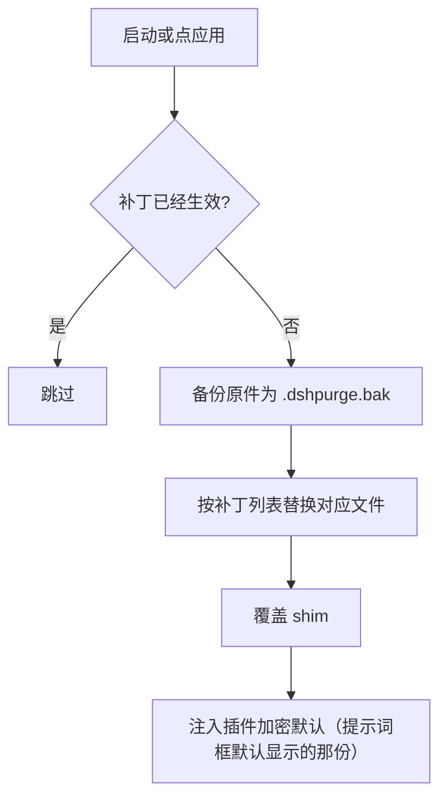
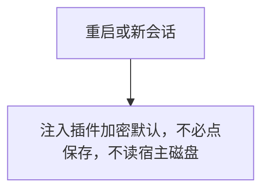
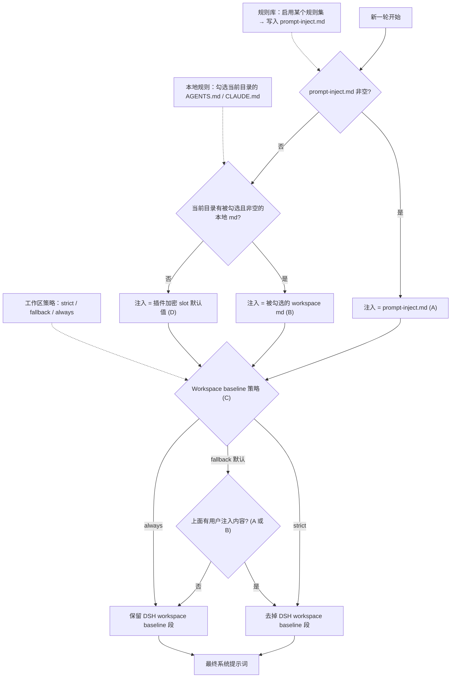

<p align="center">
  
</p>

<h1 align="center">⚔️ DeepSeek Harness 网络安全红队工具（dsh-purge）</h1>

<p align="center"><strong>Version 1.1.89</strong></p>

<p align="center">
  <em>DeepSeek Harness 破甲：让所有模型都能破甲，不同模型可换不同提示词；默认提示词面向国模「小码酱」。内置红队进攻条令与 114 个演练技能（32 个进攻流程 + 16 个逆向与专项纵深）。</em>
</p>

<p align="center">
  <a href="https://github.com/jyhuang201900/dsh-purge/stargazers"></a>
  <a href="https://github.com/jyhuang201900/dsh-purge/blob/master/LICENSE"></a>
  <a href="https://www.deepseek.com/harness/"></a>
  <br>
  
  
</p>

<p align="center">
  <a href="README.md"><strong>中文</strong></a> · <a href="README.en.md">English</a>
</p>


> **官方 Web 和官方桌面端都支持。** 官方 `dsh web` 用 profile `web`；官方桌面 EXE（DeepSeek Harness **0.2.2-rc.1**）用 profile `desktop`。两边分开安装、分开点「应用」。当前版本实测适配 dsh 0.2.1-rc.2 与 0.2.2-rc.1（不再兼容 0.2.0-rc.2 及更早，那些请用对应老版本插件）。社区桌面端不维护。
>
> 写进 profile 还不会改宿主。点会话标题旁的 **dsh-purge** → **清洗** → **应用**。成功会自动重启；补丁没打完不重启。重启后新开一轮对话，注入才进当前会话。
>
> Node.js **≥18**。Windows 无闪窗需要 **Node ≥22**。npm 上没有 `dsh-purge` 这个包，安装请走下面的 GitHub 归档，不要 `pnpm add dsh-purge`。

## 目录

- [介绍](#介绍)
- [许可证](#许可证)
- [适配范围](#适配范围)
- [安装](#安装)
- [界面](#界面预览)
- [使用](#使用)
- [自己的服务器](#自己的服务器)
- [工作原理](#工作原理)
- [还原](#还原)
- [更新](#更新)

---

## 介绍
## 日常会话能用什么 / 什么需要演练预设

插件的**十个工具全局注册**（`lib/index.js` 的 `ctx.tools.register`，不设预设门限），所以**日常会话直接可用，不必切红队预设**：

| 能力 | 日常会话 | 演练预设 | 说明 |
| --- | --- | --- | --- |
| 十个 `purge_*` 工具 | ✓ | ✓ | 查补丁、验收、改注入、技能体检都在 |
| **演练台**（开靶标 / 落库 / 得分 / 战报） | ✓ | ✓ | `purge_drill op=open` 就地开靶标，工具自己会提示「不必切红队预设，也不必去界面」 |
| **下一步该干什么** | ✓ | ✓ | `purge_drill`（不带参数=summary）按事实库状态给**一句**针对性指引并点名该加载的技能：无资产 → ①`recon-pipeline`；有资产 → ③`asset-correlation`+`nuclei-scan`；有漏洞 → ④`injection-payloads`/`webshell-toolkit`；有权限 → 建隧道 `suo5-tunnel`；有隧道无内网 → ⑤`gogo-intranet`；有内网 → `fscan-intranet` 打点。**日常会话不开演练预设也有五阶段纪律** |
| **按阶段找技能** | ✓ | ✓ | `purge_skills all=1..5` 或 `all=flow`，按信息收集/资产梳理/漏洞发现/漏洞利用/内网渗透列该段技能 |
| **查技能库 / 读技能正文** | ✓ | ✓ | `purge_skills` 列全库与体检；`purge_skills id=<技能名>` 回**链路位置 + 正文头部 + 完整路径**——日常读技能的**唯一入口**（红队技能不在日常的 `<available_skills>` 里） |
| **用 `skill` 工具加载这 114 个技能** | ✗ | ✓ | 技能由演练预设的 `customSkillDirs` 发现；日常会话看不到它们，避免 114 条描述常驻上下文 |
| **注入条令**（五阶段 / 军规 / 链路纪律） | ✗ | ✓ | `isRedteamSession(context)` 判定，只在演练会话注入 |

**为什么这么切**：把 114 个技能塞进每个日常会话，等于每次对话都先读 114 条技能描述 —— 预设注释里写得很清楚，这是刻意关掉的（`includeDefaultRoots: false`）。

**日常要用红队能力，两条路**：① 直接调工具（含演练台，开个靶标就能跑）；② `purge_skills id=<技能名>` 按需读技能正文，不必切预设。需要模型的技能目录与条令约束时，再切演练预设。


装在本机官方 [DeepSeek Harness](https://www.deepseek.com/harness/) 上的网络安全红队评测插件。官方 **Web**（`dsh web`）和官方 **桌面端**（EXE）都支持，两边分开装、分开点「应用」。

Harness 不只是把问题交给模型。它还会在运行时改提示词、审批门、沙箱和会话格式。只看「模型答不答」，会把宿主拦截误当成模型拒绝。本插件在你自己的安装里把这两层分开，用来做受控评测，也用来看默认策略该不该收紧。


| 你会用到             | 它做什么                                            |
| ---------------- | ----------------------------------------------- |
| **dsh-purge 侧栏** | 会话标题旁的按钮打开右侧栏，分层导航：首页 → 分区 → 子层，层间用面包屑返回        |
| **清洗**           | 分组查看补丁，应用、还原、卸载；编辑提示词和多套规则                      |
| **演练台**          | 内置。授权后查看资产、技能和本机环境。只用于你有权管理的本机、离线靶标或已书面授权的演练 |
| **宿主策略**         | 调整默认文案、权限策略和工具上限。官方能力保留，不另写一套身份                 |
| **启动时**          | 自动再检查并应用。npm 升级盖掉 `node_modules` 之后不用手改文件       |


不写死盘符。按 `$DSH_HOME`、dsh 启动器旁边的 `.dsh`，再退回 `~/.dsh`。不改 Harness 源码仓库，在 **dsh-purge** 的「清洗」里点「应用」才写入。身份来自插件里的加密提示词，也就是提示词框默认显示的那一份。不读取宿主磁盘上的提示词文件。

本插件只动本机已经装好的官方 `@deepseek-ai` 包和本机配置。它不是公网扫描器，也不是打别人站点的套件。仓库里没有木马，也没有对外攻击载荷。

---

## 许可证

许可条款见 [LICENSE](./LICENSE)。个人本机使用、修改、二次分发都可以，二次分发时保留来源仓库链接。

---

### 使用范围与免责

1. **只作用于本机官方 Harness**：补丁、提示词注入、回滚、卸载全部发生在使用者本机已安装的官方 DeepSeek Harness（`@deepseek-ai` 包、本机 profile / `$DSH_HOME`）上，对象是自己的本地软件，不是他人的网站、服务器、账号或信息系统。
2. **对外发包由使用者负责**：演练台、扫描、爆破、隧道会向目标真实发包。目标必须是你有权操作的环境——本机、离线靶标、授权演练场或已书面授权的公网目标。
3. **合规自行判断**：使用者自行遵守所在地法律法规与平台规范，独立承担使用后果。
4. **与 DeepSeek 无隶属关系**：文中「官方」仅指评测对象是官方 DeepSeek Harness 软件包，不代表 DeepSeek 开发、认可或担保本插件。

---

## 适配范围

最新版只支持 **dsh 0.2**，不要拿它去打 0.1.x。

- **dsh 0.2.1-rc.2 / 0.2.2-rc.1**（官方桌面 / 官方 `dsh web`）：用 **1.1.40** 及以上。本页命令装的就是这一档。
- **dsh 0.1.7**（含 rc.1 / rc.2）：用 **1.1.39** 及更早 —— 在 [Releases](https://github.com/jyhuang201900/dsh-purge/releases) 里选对应标签。

对不上的补丁会显示待应用或跳过，不会乱改文件。

---

## 安装

现在只维护官方 `dsh web` 和官方桌面 EXE，**两边都要装、分开应用**。Web 的包进不了桌面端，桌面端的包也进不了 Web。

**Web（官方 `dsh web`）**

```sh
dsh plugin --profile web add https://github.com/jyhuang201900/dsh-purge/archive/refs/heads/master.tar.gz
```

**桌面端（官方 EXE）**

```sh
dsh plugin --profile desktop add https://github.com/jyhuang201900/dsh-purge/archive/refs/heads/master.tar.gz
```

当前目录已经是本仓库时，把归档地址换成 `add .`。`dsh` 不在 PATH 时走 [手动安装](#manual)。

插件市场里按 npm 包名搜会 404（npm 上没有这个包），用上面的 GitHub 归档命令。桌面客户端也可以点按钮（`dsh://` 唤起，下载地址已是 GitHub）：

<p align="center">
  <a href="dsh://plugin/install?id=dsh-purge&name=dsh-purge&version=1.1.89&repo=jyhuang201900%2Fdsh-purge&permissions=%E7%B3%BB%E7%BB%9F%E6%8F%90%E7%A4%BA%E8%AF%8D%E6%B3%A8%E5%85%A5%2C%E6%9C%AC%E6%9C%BA%E8%A1%A5%E4%B8%81%2C%E8%AE%BE%E7%BD%AE%E9%A1%B5&downloadUrl=https%3A%2F%2Fgithub.com%2Fjyhuang201900%2Fdsh-purge%2Farchive%2Frefs%2Fheads%2Fmaster.tar.gz"><strong>唤起客户端一键安装</strong></a>
</p>

### 装完都要做这三步

只把插件写进 profile **还不会**改 `@deepseek-ai`。

1. **退出并重新打开**刚装的那个宿主：Web 关掉 `dsh web` 再开；桌面端退出托盘再打开对应 exe。
2. 在**这个宿主**点会话标题旁的 **dsh-purge**，在 **清洗** 页点 **「应用」**。宿主的设置页里没有这个条目。
3. 「应用」成功后会自动重启一次，让补丁进入当前进程。没做完不会重启。

Web 的控件只动 Web，桌面端的只动桌面应用。不要在一个宿主里点另一个宿主的应用。

### 怎样算装上了

- 会话标题旁有 **dsh-purge**，点开后在「清洗」里能点「应用」。
- 聊天里 `/purge status` 能打出 `DSH_HOME` 和补丁列表，路径应是你正在用的那一份。
- 没装的可选包（例如梁神）显示跳过，不挡住应用完成。

### 交给助手安装

把下面整段发给本机助手。它只执行安装命令：不要全盘搜索、不要改其它文件、不要代点「应用」、不要重启。

<details>
<summary><strong>给 AI 助手（只安装）</strong></summary>

<!-- AI-AGENT-START -->

安装 DeepSeek Harness 插件 `dsh-purge`，Web 和官方桌面端都要装。不要全盘搜索，不要读或改其它文件，不要应用设置，也不要重启应用。

`dsh` 不在 PATH 就告诉用户后停止。当前目录已是本仓库时，把下面两条里的归档地址都换成 `.`。某个 profile 不存在就跳过那一条，另一条照装。npm 上没有这个包，不要 `pnpm add dsh-purge`。

**Web 端（官方 `dsh web`）**

```sh
dsh plugin --profile web add https://github.com/jyhuang201900/dsh-purge/archive/refs/heads/master.tar.gz
```

**桌面端（官方 EXE）**

```sh
dsh plugin --profile desktop add https://github.com/jyhuang201900/dsh-purge/archive/refs/heads/master.tar.gz
```

命令结束后，提醒用户：Web 完全退出并重启 `dsh web`；桌面端退出托盘再打开 EXE。各自点会话标题旁的 **dsh-purge**，在「清洗」里点「应用」。然后停止。

<!-- AI-AGENT-END -->

</details>

<a id="manual"></a>

### 手动安装

命令行装不上、或 `dsh` 不在 PATH 时用这个。只改**正在用的那个宿主**对应的 profile，不要动另一个，也不要删原有 bundle。

<details>
<summary><strong>完整手动步骤</strong></summary>

**1. 找到真正在用的 `$DSH_HOME`。** 认目录：名字是 `.dsh`（官方 EXE 偶见 `dsh-home`），里面有 `profiles`，且至少有一个 `profiles/<名>/package.json`。按顺序找：`DSH_HOME` 环境变量 → 安装根旁边的 `.dsh`（便携包）→ `%USERPROFILE%\.dsh` 或 `~/.dsh` → `%APPDATA%` / `%LOCALAPPDATA%\DeepSeek Harness\dsh-home`。确认：`profiles/web/package.json` 里 `"name"` 是 `dsh-profile-web`（桌面是 `dsh-profile-desktop`）。本机常有两份 `.dsh`，要用你**实际启动**的那个宿主对应的那份。

Windows PowerShell 列候选：

```powershell
$cands = @()
if ($env:DSH_HOME) { $cands += $env:DSH_HOME }
$cands += "$env:USERPROFILE\.dsh"
$dsh = Get-Command dsh -ErrorAction SilentlyContinue
if ($dsh) {
  $dir = Split-Path $dsh.Source
  $cands += @((Join-Path $dir ".dsh"), (Join-Path (Split-Path $dir) ".dsh"), (Join-Path (Split-Path (Split-Path $dir)) ".dsh"))
}
$cands += @("$env:APPDATA\DeepSeek Harness\dsh-home", "$env:LOCALAPPDATA\DeepSeek Harness\dsh-home")
$cands | Select-Object -Unique | Where-Object { $_ -and (Test-Path (Join-Path $_ "profiles")) }
```

**2. 把插件放到 `$DSH_HOME/plugins/dsh-purge`**（目录名必须是 `dsh-purge`，其 `package.json` 里 `"name"` 也必须是 `dsh-purge`）。

```sh
git clone https://github.com/jyhuang201900/dsh-purge.git "$DSH_HOME/plugins/dsh-purge"
```

没有 git：下载 [master.tar.gz](https://github.com/jyhuang201900/dsh-purge/archive/refs/heads/master.tar.gz)，解压后把 `dsh-purge-master` 改名为 `dsh-purge`，整夹放到 `plugins` 下。已有本仓库副本就复制整个目录，不要只拷几个 `.js`。

**3. 只改对应 profile 的 `package.json`，先备份。** Web → `$DSH_HOME/profiles/web/package.json`；桌面 → `$DSH_HOME/profiles/desktop/package.json`。**只追加两处**，原有依赖和 bundle 全部留着：

1. `dependencies` 增加 `"dsh-purge": "file:../../plugins/dsh-purge"`
2. `dsh.profile.bundles` **末尾**追加 `"dsh-purge"`（已有就不要再加）

```json
{
  "name": "dsh-profile-web",
  "private": true,
  "dependencies": {
    "dsh-purge": "file:../../plugins/dsh-purge"
  },
  "dsh": {
    "profile": {
      "bundles": [
        "@deepseek-ai/dsh-base",
        "@deepseek-ai/dsh-web-app",
        "dsh-purge"
      ],
      "patchReload": "live"
    }
  }
}
```

JSON 要合法（新增项前面有逗号，最后一项后面没有多余逗号）。`file:../../plugins/dsh-purge` 不要改成绝对路径，`patchReload`、其它插件、版本号都不要动，`"dsh-purge"` 不要写两次。桌面端没有 `dsh-web-app` 就不要硬加。

**4. 只在刚改的那个 profile 目录装依赖**（`cd` 进 profile 目录，不要在仓库根或 `$DSH_HOME` 根）：

```sh
cd "$DSH_HOME/profiles/web"   # 或 profiles/desktop
pnpm install
```

成功标志：出现 `profiles/<web|desktop>/node_modules/dsh-purge/package.json`。找不到 `pnpm` 就用官方 `dsh` 自带的 Node / pnpm；报 `Could not resolve` 就检查 `file:` 路径；JSON 解析失败就修逗号或还原备份。

**5. 完全退出该宿主，再启动，再点「应用」** —— 和上面三步一样。按钮会出现在会话标题旁，只在这个宿主点「应用」（或 `/purge apply`）。没出现多半是改错了另一份 `.dsh`，回到第 1 步核对。

</details>

### 卸载

会话标题旁的 **dsh-purge** →「清洗」→「卸载」。弹窗确认：会先还原已应用的补丁，还原回原版 Harness，再重启当前宿主。

```sh
# 也可以用命令行 / 聊天
dsh-purge --uninstall
# /purge uninstall
```

插件配置在 `cordis.patch.yml`（`postPrompt` 默认为空）：

```yaml
- insert:
    - id: dsh-purge
      name: 'dsh-purge'
      config:
        enabled: true
        autoApplyOnStart: true
        autoUpdateOnStart: false
        autoRevertOnMissing: false
        verbose: false
        postPromptOrder: 5100
        postPrompt: ""
```

---

## 界面预览

会话标题旁有 **dsh-purge**。点开是右侧栏，两页：**清洗** 和 **演练台**。白 / 墨可切换。补丁按组展开，进度只计真正已应用的项。规则集在上方列表启用或删除，下方编辑正文。

第一次进演练台要先读声明、等倒计时、滚到文末并勾选三项。清洗不需要这一步。演练台只用于你有权管理的本机、离线靶标，或已经书面授权的演练环境。

**清洗**


**演练台授权**


**演练台**


**补丁**


**规则集**


**自己的服务器**

在清洗页，提示词下面。每行一台，点保存名单。步骤见 [自己的服务器](#自己的服务器)。


| 区域        | 说明                                                                                                         |
| --------- | ---------------------------------------------------------------------------------------------------------- |
| dsh-purge | 会话标题旁的按钮，打开或收起右侧栏                                                                                          |
| 清洗        | 原来的规则设定：补丁、提示词、规则集、Skill                                                                                   |
| 演练台       | 授权后的资产、技能与环境页。未授权时按钮标「未授权」                                                                                 |
| 补丁        | 分组查看状态，应用、还原或卸载                                                                                            |
| 提示词       | 编辑 `prompt-inject.md`，作为会话覆盖段                                                                              |
| 自己的服务器    | 每行登记一个 IP 或完整主机名，保存后写入 `$DSH_HOME/net-scope-allow.txt`                                                     |
| 规则集       | 多套 `AGENTS.md` / `CLAUDE.md`；启用写入 `$DSH_HOME`，删除从列表去掉                                                      |
| Skill     | 导入压缩包或文件夹到当前宿主官方目录 `$DSH_HOME/skills/<id>/SKILL.md`（Web / 桌面各用自己的主目录，不写死盘符）；命中、加载、`/名称` 由 DSH 负责。也可自己删该文件夹 |


---

## 目录结构

`bin/` 是命令行，`lib/` 是补丁和演练台，`presets/redteam/` 是红队预设，`skills/redteam/` 是随包技能，`client.js` 是侧栏。

运行时文件在 `$DSH_HOME`：`prompt-inject.md`、`rules/`、`skills/`、`net-scope-allow.txt`、`redteam/`。未设 `DSH_HOME` 时，优先用 dsh 安装目录旁边的 `.dsh`，再退回 `~/.dsh`。Web 和桌面端各用自己那一份主目录。Skill 不进注入段，也不顶替提示词。

---

## 使用

```sh
# CLI
dsh-purge --status

另有一个手动入口：`node lib/reapply-cli.js` —— 不开宿主也能重刷已安装副本（它显式 `scheduleSwap: false`，不会替你安排重启）。**注意它的 `ok` 判据与 `--status` 不同源**（CLI 报 `applied=64` 时 `--status` 仍是 `74/76`，因为 reapply 在试验目录里自己验收并可能回滚），排障时两个都要看。
dsh-purge --apply
dsh-purge --align      # 对齐体检（只读）
dsh-purge --tools      # 列出模型工具契约
dsh-purge --drill ops  # 演练台聚合查询/写入（op 可省，缺省 summary）
dsh-purge --mcp        # 以 MCP server 跑（stdio）
dsh-purge --revert
dsh-purge --uninstall
dsh-purge --edit

# 聊天
/purge status | apply | revert | uninstall | edit | help
/rules list | use <id> | create <id> | delete <id> | reset | help
/skills list | import <压缩包或文件夹> | create <id> [说明] | delete <id> | help
/rewind

# 模型工具
purge_status     purge_align      purge_apply      purge_revert
purge_patch      purge_update     purge_rules      purge_skills
```

设置页「应用」成功后会自动重启，以加载已改的包文件；也可手动点「重启」。补丁标题下有正式版和测试版。测试版跟 `beta` 分支。点「切换到正式版」会装回 master，并清掉钉选。正式版里选旧版本会固定在该版本，要回到最新再点「更新」。旧的测试标签不再列出。

输入框旁的「回退一次」和「回退上一轮」跟官方 DSH `session.fork({ atSeq })`：撤回已进行的那一轮，新会话接上之前的上下文，旧会话归档，那句回到输入框，再发送会重新注入。聊天里 `/rewind` 同样可用。

**极简 / PTC 与标准不一致时**：同一任务在标准模式能跑、在极简或 PTC 被拦，通常是 preset 里 `run_code` 或 plan 拦截句没洗净，或内置 minimal 缺少 `agent-instructions`。请升到 **1.1.61+**，**完全退出宿主 → 清洗里应用 → 自动重启 → 新开一轮对话** 再试；只换 preset 不重应用，旧进程里的补丁不会更新。

### 响应速度

DSH 会按顺序执行同一批中的 Bash 调用。旧版 dsh-purge 把默认前台等待从 60 秒提高到了 10 分钟，一条慢命令会让后续调用一起等待。补丁 #21 现在把带插件标记的旧值恢复为官方的 60 秒。无标记的等待时间和其他自定义值会保留；无标记的 10 分钟无法可靠地区分是插件旧值还是用户设置。

在 macOS/Linux 的 `dsh web` 中，如需更快返回工具结果，可在 `$DSH_HOME/profiles/web/cordis.patch.yml`（通常是 `~/.dsh/profiles/web/cordis.patch.yml`）添加下面的条目。已有相同 id 时修改原条目，不要重复添加。这个 profile 覆盖层在内置配置之后加载，后续应用插件会保留它。

```yaml
- id: bash-sandbox
  config:
    timeoutMs: 10000
```

使用标准 jobs 服务且 `promoteOnTimeout: true` 时，未完成的命令会在 10 秒后返回后台任务 id，并继续运行。用 `job_output` 读取结果、用 `job_kill` 停止。这个设置缩短前台等待，不会让命令本身跑得更快。没有 jobs 服务或关闭自动转后台时，超时会终止命令。单次调用传入的 `timeoutMs` 优先于这里的默认值；`run_in_background: true` 可立即返回任务 id。

日常任务还可以选择让新会话默认使用 Low 推理：

```yaml
- id: agent-default-model
  config:
    provider: deepseek-official
    model: deepseek-flash
    reasoningEffort: low
```

重启 `dsh web` 后加载配置。模型和推理等级默认值只用于新建会话，已有会话请在输入框中选择 Low。插件不会自动修改这些模型偏好。需要深入推理的任务可保留 High；搜索文件时应限定目录，避免递归扫描所有应用目录。

### 自己的服务器

中国大陆、香港、澳门的地址默认禁止。只有事先登记的那一台可以例外。在对话里说「这是我的服务器」不会放行。密钥和密码也不会。

这一栏在提示词下面。若侧栏里还没有它，先完全退出 DeepSeek Harness，再重新打开。

1. 点会话标题旁的 **dsh-purge**，停在 **清洗**。
2. 往下滚过 **提示词**，下面就是 **自己的服务器**。
3. 每行只写一台，用下面三种写法之一：
  - `203.0.113.10`：一个 IP。
  - `my-vps.example.com`：一个完整主机名。保存后，这个主机名当时解析出来的地址也会放行。
  - `alice@my-vps.example.com`：账号只用来认出这种写法，不能证明这台机器属于你。
4. 点 **保存名单**。名单写在 `$DSH_HOME/net-scope-allow.txt`。
5. 密钥、密码、网段和通配符会在保存时丢掉。没有写进名单的大陆、香港、澳门地址仍然禁止。

上面的 `203.0.113.10` 和 `example.com` 只是写法示例，不是放行地址。把它们换成你自己的那一台再保存。

---

## 本地校验

一条命令过十六关（语法 / 体积预算 / 双语文案（含源↔内联）/ 清单一致性 / 包自证 / 工具面 / 端到端情景 / 弹药层审计 / 磁盘卫生夹具 / CLI 冒烟 / 写路径冒烟 / 工具层冒烟 / 纸面功夫 / 技能流水线 / 范围闸 / JSON 合法），未通过时退出码非 0：

迭代时可以点跳重活：`node scripts/verify.mjs --skip write,cli`（或 `DSH_VERIFY_SKIP=write,cli`）。实测三档耗时：全量 12 关 22.3 秒 → 跳 `write` 7.6 秒 → 再跳 `cli` 5.1 秒（旧参数 `--skip-size` 实为「除语法外全跳」，2.4 秒；名字与行为不一致，保留兼容但新用法以 `--skip` 为准）。可用短名：`size,locale,manifest,package,tools,scenario,ammo,hygiene,cli,write,json`。

```sh
npm run verify
```

### 方法论五则（按本仓库踩坑频次排序，不是格言是能省的力气）

1. **先量再写。** 任何「我记得它是这样」都要一条命令证明——绝大多数返工都出在猜锚点、猜函数签名、猜字段名上。
2. **回读不说谎。** 写操作必须回读真值：`updated:true` 可能是静默不改，`counts` 可能是处理条数而不是新增条数。
3. **门要红得对。** 每道门都要有「改坏即红」的证据；宽正则、可选前缀、指错脚本都会让门误报或空转，那种门比没有门更会骗人。
4. **多点改动分步落盘。** 把几处编辑塞进一个批处理，一处解析期失败就整批不写；跨 PowerShell→脚本→代码三层的引号/转义是头号杀手。
5. **环境不是事实。** 每条命令都是新进程，缺 `DSH_BASE` 会把「未知」显示成一套假数字；会写文件的命令别截管道，否则中途被杀还说不出原因。

### 三面入口矩阵（命令 × 面板路由 × 模型工具）

| 能力 | `/purge` 等命令 | 面板路由 | 模型工具 | 说明 |
| --- | --- | --- | --- | --- |
| 状态 | `/purge status` | `GET /status` | `purge_status` | 三面齐 |
| 应用清洗 | `/purge apply` | `GET /apply` | `purge_apply`（可 `patches=` 选打） | 选打会先恢复 `.bak`，未选中的会回滚 |
| 回滚还原 | `/purge revert` | `GET /revert` | `purge_revert` | 三面齐 |
| 卸载 | `/purge uninstall`（别名 `remove`） | `GET /uninstall` | — | 工具面故意不做：模型自卸载等于自己拆台 |
| 注入正文 | `/purge edit` | `GET/POST /override` | `purge_override`（show/reset） | 编辑留人，读状态给模型 |
| 对齐体检 | `/purge align` | — | `purge_align` | 本轮补齐命令面（原先只有工具与 CLI） |
| 更新现状 | `/purge update` | `GET /update`（执行） | `purge_update`（读） | 命令与工具只读现状，按钮才是动作 |
| 规则集 | `/rules` | `GET /rules` | `purge_rules` | 独立顶层命令 |
| 技能 | `/skills` | `GET /skills` + `/skill` | `purge_skills` | 同上 |
| 补丁明细 | `/purge status`（含逐条） | 面板展示 | `purge_patch` | 单一来源：都读 `patchTally()` |
| 演练台 | —（预设面有 56 个 `redteam_*`） | `GET /drill-grant` | `purge_drill`（18 op） | 模型面主打；命令面不做，避免第二套话术 |
| 会话回退 | `/rewind` | `GET /rewind` + `/rewind/options` | — | 会话动作，模型自己 rewind 有风险 |
| MCP 通路 | — | `POST /mcp` | 与 `ctx.tools` 同一张表 | 传输层，不是能力 |

**故意不三面平铺的判据**：配置/状态类要能被模型读到；UI 动作类（`restart`、rewind、uninstall）给了模型反而危险。**每条豁免都写在这张表里，不留口头账**；`/purge` 的子命令与 hint 由 `check-package` 第 20 项对账（别名按 fall-through 规则自动识别，不用手填清单）。

包自证里有一类**自我约束型断言**——它们不检查外部世界，只检查 purge 有没有偷偷变胖：闸门条数（文档说几关就得是几关）、发布清单与自更新清单不分叉、工具数（文档写的 N 个 == 源码 `purge_*` 定义数）、默认注入正文体积（≤ 33,000 字）、提示词层净增减（≤ 2,000 字；只有这一层真的烧 token，代码层增减不算）、中英文案组数。

全部本地入口（14 个，逐个都有存在理由；少写一个就等于少一道门）：

| 命令 | 管什么 |
| --- | --- |
| `npm run embed-prompt` | 把默认注入正文重封进 `lib/asset-table.js`（改了源必须跑，否则宿主拿旧稿） |
| `npm run check-anchors` | 逐条补丁锚点对已发布宿主产物核对（`--old` 现在会自动推断上一档） |
| `npm run check:upstream` | 上游漂移探测：npm 上 dsh 的最新版是否还是我钉的 `dshTarget`；engines 越界判失败，查不到只报未知 |
| `npm run sweep:market` | 生态漂移探测：目录规模、钉住口径下的 `restart ∩ patch` 交集与邻居版本；交集被吃进判失败，离线只报未知 |
| `npm run check-size` | 每文件体积预算（默认上限 200KB） |
| `npm run check:locale` | `client.js` 里中英两块 329 组文案 key 的一致性 |
| `npm run build:locale` | 由 `locale/*.json` 生成内联块；`--check` 验源与内联不分叉 |
| `npm run check:manifest` | 自更新拷贝清单与发布白名单不分叉 |
| `npm run check:package` | manifest 字段、发布文件、全仓数量声明、生态 tag、闸门数、注入体积与平面基线 |
| `npm run check:tools` | 工具面预算：结构、描述成本、返回值、可发现性 |
| `npm run check:toolkit` | toolkit 巡检：目录在但零 `.exe` ＝ 装过被删（先加白名单再重装）；可挂定时任务，红了才看 |
| pm run check:asar | asar 切换形态闸门：混合态解混合 / 不完整目录拒绝切换 / 健康快照认混合态（夹具实跑，不碰真实安装） |
| `npm run scenario` | 端到端情景：串 drill 的 op 逐步断言回读 + 真机只读探针 |
| `npm run probe:gates` | 闸门反向探针总表：逐关改坏即红（没咬过的门等于不知道真假的门） |
| `npm run audit:skills` | 弹药层一致性：技能正文引用的 `redteam_*` 工具名、条令点名的技能，都必须真实存在 |
| `npm run sync:bundled` | 把仓源随包资源同步到运行时：**技能**（`skills/redteam` → `~/.dsh/redteam/skills`，由预设 `customSkillDirs` 发现）+ **红队预设**（`presets/redteam` → `~/.dsh/.agent-presets/redteam`，`core.js` 只读这个路径）。幂等；预设内容不同默认只报告（怕盖掉你的改动），`--force` 才覆盖。别名 `sync:skills` |
| `npm run build:skills-graph` | **技能链路层**：扫描 `skills/redteam`，生成 `lib/generated/{skills-index,skills-relations,skills-agents}.json`（索引 / 关系表 / 角色档案），把「链路位置」（上游→本技能→下游→互补→落库）写进每个技能正文，并把「角色技能库总表」派生进预设。一个命令同步四个模块，幂等可重跑。链路一致性与零入边由 `audit-skills` 硬校验 |
| `npm run runnable:inject` / `runnable:check` | **纸面功夫**：探测每个技能命令用到的工具在本机（PATH 与 toolkit 双探）有没有，给技能注入「本机可执行性」块（缺什么、`npm run toolkit:windows --only X` 怎么装、Windows 上用哪个等价物），`--check` 只校验。技能厚不等于打得出去——这关保证落差写在技能自己的上下文里 |
| `npm run build:skills` / `quality:second-shot` | **技能构建流水线**（一条命令四步，顺序固定、幂等）：标题规范化（合并块内下沉，保证一技能一 H1）→ 本机可执行性 → 第二发 → 链路与档案。`--check` 只校验三项质量。`quality:second-shot` 单独看第二发覆盖率 |
| `npm run scope:check` | **范围闸自测**：靶标授权范围内才许落库。机制借自 `@integsec/agentic-pentest-proxy` 的 scope manifest——每个目标都校验、一个越界就整条拦下、**排除项优先**、CIDR 必须完全落在授权内、判不了（DNS/IPv6/乱串）也算不过。同时钉「拦截真的发生在写入路径上」而不只是函数正确 |
| 三道授权边界 | **目标 / 技法 / 时间窗**，缺一条就等于没有边界。开靶标时一并给：`purge_drill op=open name=X target=203.0.113.0/24 scope="tech=noisy,passive,deny=destructive,from=2026-11-11T00:00,to=2026-11-12T00:00"`。`tech`=授权技法（noisy/passive/exploit/destructive/reverse/appsec/specialty/surface）、`deny`=排除技法（**优先于授权**）、`from`/`to`=时间窗（**过窗与未到起点都拦**）。落库时按 `entity_add` 的 target 判目标范围；写攻击步骤时按 `chain_add` 的 `tool` 判技法与时间 |
| `npm run toolkit:windows` / `toolkit:check` | 红队工具链的 **Windows** 装配器与体检：走 GitHub 官方 API 取 `windows_amd64` 资产装到 `$DSH_HOME/redteam/toolkit`（仓里的 `setup.sh` 是 Linux 专用，Windows 上每个都报无匹配资产）；`--check` 只体检。已知 `ksubdomain` 无 Windows 构建 |
| `npm run wordlists:windows` | **字典装配**：把技能里引用的 SecLists 字典在 Windows 上落地（`$DSH_HOME/redteam/wordlists`）。技能里写的是 `/usr/share/seclists/...`，而 Windows 会把它当**相对路径**拼到盘符后面（实测 ffuf 报 `E:\usr\share\seclists\...` 找不到）——所以不装字典，`ffuf`/`feroxbuster` 的命令**必然失败**。`--check` 只看状态；下载走 curl 代理回退（与 `toolkit:windows` 同一条路） |
| `npm run test:hygiene` | 磁盘卫生模块夹具：prev 保留上限、孤儿对计数、坏 JSON 不许静默跳过 |
| `npm run smoke:cli` | CLI 冒烟：真跑 `bin` 的只读模式，验参数分发与输出标志（未知旗标须报错，不许静默当 status） |
| `npm run smoke:write` | 写路径冒烟：在临时夹具上跑 revert→apply→apply→revert，逐文件字节对账（apply 幂等、revert 往返、跑完自收尾） |
| `npm run smoke:tools` | 工具层冒烟：真执行 `purge_apply` / `purge_revert`，断言返回的 hosts 数与「单次往返逐文件回到官方原文」 |
| `npm run audit:graph` | 图谱孤儿审计：找零入边且无人提名的代码文件（有名分的手动 CLI 不算孤儿） |
| `npm run report` | 体检报告：按顺序复用十六关与探测器，产出 markdown 汇总表（`.cache/report-<日期>.md`）；`--no-net` 跳过三条外网项，`npm run report -- --check-debt` 追加「挂账复查」段（逐条复查验收单第六节：路由是否随重启转绿、注入字数、本轮残差、真宿主 sidecar 取证、刻意没做的四项）。耗时由脚本自测；未重启时 `--verify-live` 那一行为 exit=1 属常态，不是新缺陷 |
| `npm run verify` | 一条命令过八关 |
| `npm run build:client` | 重打前端 bundle |
| `npm run graphify` | 重建知识图谱（AST + 手写语义层） |
| `npm run host-sync` | 把 profile 里的已安装副本指到当前 commit（按内容指纹核对，不看声明） |

跑法：`node scripts/verify.mjs --skip-size` 可跳过体积关快速自检。

---

## 工作原理

应用，启动时或手动点「应用」：




每次会话的覆盖：




每一轮的提示词注入与规则集决策。左边三个输入就是你在 dsh-purge 面板里控制的东西，虚线表示它们各自驱动哪一步判定：




Skill 不进注入段：


---

## 还原

- 每个目标文件在应用前备份为 `<文件>.dshpurge.bak`。
- 「还原」或 `/purge revert` 用备份覆盖回去并删除备份；没有备份时去掉 shim 里由本插件写入的行。
- `prompt-inject.md` 是用户文件，还原时保留。
- 「卸载」会先还原（若已应用），再删除注入文件、规则库和插件本身。
- 重复应用是幂等的。

---

## 路径探测

宿主面先判断 `web` / `desktop`（预留 `gui` / `tui`，尚未单独适配时回退 web）。

**Web：**

1. `DSH_HOME` / `DSH_BASE`
2. dsh 启动器旁的 `.dsh`
3. `npm prefix -g` / `npm root -g`
4. 嵌套 `@deepseek-ai/dsh/node_modules/@deepseek-ai`
5. 系统默认 `~/.dsh`

**官方桌面：** 只改当前正在运行的官方桌面安装。点「应用」成功后会自动重启一次。社区桌面端不维护。

找不到目标时提示设置 `DSH_BASE`，不改文件。

---

## 更新

版本说明见 [release-notes.md](./release-notes.md) 与 [Releases](https://github.com/jyhuang201900/dsh-purge/releases)。

知识图谱：语义层在 `graphify-out/semantic/`，规范见 [docs/graphify-语义层规范.md](./docs/graphify-语义层规范.md)，重跑一条命令 `node scripts/graphify-sync.mjs --cluster`。

## 联动 / 生态

本机桌面 profile 同时装了 8 个第三方 dsh 插件，各管一段、互不重复。**dsh-purge 管的是「策略与补丁」这一层**：

| 插件 | 它管什么 | 与 purge 的关系 |
| --- | --- | --- |
| `dsh-mnemon` | 组合式记忆（view-based sources / strategies） | 记忆归它；purge 的注入正文是它的上游文案 |
| `dsh-context` | 上下文洞察（Stats / 趋势 / 浏览器 / 事件） | 观测 token；purge 观测策略与补丁命中 |
| `dsh-free-search` | 搜索工具面（27 engines） | 同为「给模型加工具」，purge 现也走 MCP |
| `dsh-ops` | 原生 file / PTC 工具、可选只读侧栏 | 侧栏并存；purge 的侧栏只管清洗与演练台 |
| `dsh-better-sidebar` | 文件树 / 编辑 / 变更 / 任务 / 侧聊合一 | 侧栏形态参考 |
| `@panando/dsh-codex-harness`、`@xmanrui/dsh-im` | 编码 harness、IM 接入 | 与 purge 正交 |

purge 给模型的入口有三条，共用同一张契约表（`lib/model-tools.js`，10 个工具：status / align / apply / revert / patch / update / rules / skills / override / drill）：

**能力账（只放机器算得出的数，全部由 `check-package` 第 21 项对账）**：10 个工具、`purge_drill` 18 op、22 个实体（读 10 + 写 12）、端到端情景 46 步、九道闸门。写方法覆盖 27/31（87%），剩下 4 个（`close`、`seedStages`、`seedScorePoints`、`writePromptManifest`）是有意豁免——理由见上面三面矩阵与 release-notes，不是没查。

1. **dsh 会话内**：插件激活时直接 `ctx.tools.register`，模型看到 `purge_*`。
2. **MCP over stdio**：`node bin/dsh-purge.js --mcp`，任何 MCP 客户端可连，不需要 dsh 在跑。
3. **MCP over HTTP**：宿主内 `POST /dsh-purge/mcp`（JSON-RPC 2.0），可配到官方 `@deepseek-ai/dsh-mcp-client` 的 `streamable-http` 分支上，**不必再起子进程**。自检一条命令：`dsh-purge --mcp-probe [baseUrl]`（缺省读 `DSH_WEB_URL`），会分别报 live / 待重启 / 宿主不可达 / 缺 baseUrl，并打出每步耗时：

   ```yaml
   transport: streamable-http
   serverName: dsh-purge
   url: http://127.0.0.1:<你的 dsh 端口>/dsh-purge/mcp
   ```

   被连接后模型侧工具名形如 `mcp__dsh-purge__purge_drill`（`mcp__<serverName>__<rawName>`，已在宿主源码核实）。注意 `dsh-mcp-client` 目前不在本机 profile 的 bundles 里，要用得先启用它。离线自查用 `dsh-purge --tools` 与 `dsh-purge --drill`。

**定位（2000 条目录样本实测，2026-11-09）**：提到需要重启的有 26 条、提到补丁的有 36 条，**两者同时出现的为 0** —— 「文件级补丁 + 需重启生效」这套治理目前没有同路人；而带 Web UI 的插件占 72.5%，所以有界面不构成差异点。

### 上架前的一条命名现实（第 88 轮实测）

目录站 `dshmp` 上 `?q=purge` 命中的 6 个插件全是「清会话 / 清残留」一族（`dsh-session-purge` 等），**没有一个做指令治理**；而 `dsh-purge` 自己**尚未上架**。
另外该站的 `?q=` 不是名字子串过滤（`q=dsh-purge` 返回 11 条却 0 条含 purge），**判断有没有被收录只能扫分页列表，不能拿 `q=` 当存在性判据**。
所以若将来上架，显示名要带限定语——**「指令权威性清洗 / prompt-authority cleaning」**——否则在目录里会被读成第 7 个会话清理插件。口径与明细见 `docs/dsh-mcp-ecosystem-notes.md` 第 9c 节。

## 说明

- 改动范围是本机 `@deepseek-ai/*` 包里的渲染文案、默认策略和执行逻辑，以及用户目录下的覆盖文件与规则集。
- 升级后原文对不上会显示跳过，这次应用仍算完成，不会乱改。
- 不改动非 `@deepseek-ai` 的第三方插件源仓库（启动时的 CMD 无感会**尽力**修补已装的 doctor / market / 梁神 / mnemon，属运行时补丁）。
- 安装走 GitHub 归档，不要 npm 包名：`dsh plugin --profile web add https://github.com/jyhuang201900/dsh-purge/archive/refs/heads/master.tar.gz`（桌面端把 profile 换成 `desktop`）。当前目录已是本仓库时 `add .`。

---

感谢 [LINUX DO](https://linux.do) 社区

文案源已拆到 `locale/zh.json` + `locale/en.json`（329 条 × 2）；改完跑 `npm run build:locale` 内联进 `client.js`，`npm run check:locale` 会同时管中英一致与源/内联一致。
